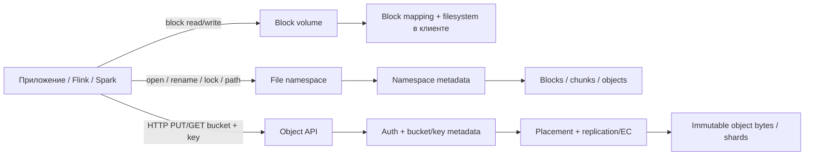
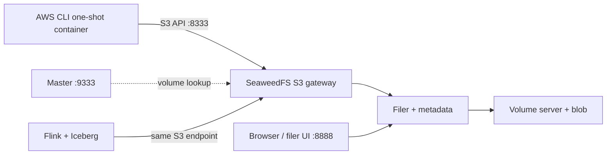

# Lesson 04b — цели, карта и границы

## Учебные цели

К концу модуля ученик должен уметь:

1. Формулировать storage contract через API, namespace, access pattern, consistency, atomicity, durability, latency и failure domain.
2. Рисовать control plane и data plane отдельно, показывая, где находятся metadata, bytes, placement map, authentication и repair.
3. Объяснять как минимум три разных write path: HDFS replicated block pipeline, Ceph RADOS placement и S3 PUT через SeaweedFS gateway.
4. Выбирать между replica и `(k,m)` erasure code через overhead `n/k`, число переносимых отказов, read/write quorum, recovery bandwidth и latency.
5. Отделять гарантии конкретного сервиса от общего S3-совместимого API и проверять семантику на реальном клиенте.
6. Учитывать маленькие объекты, список/сканирование namespace, metadata cardinality, compaction/rebalance, observability, credentials и выход из vendor lock-in.
7. Связать object storage со следующим слоем: Flink/Spark пишут файлы, Iceberg хранит транзакционные metadata, catalog публикует актуальный table state.

## Очное занятие — 4 часа; самостоятельный deep dive — 6–8 часов

| Время | Блок | Проверяемое свидетельство |
| ---: | --- | --- |
| 0–20 мин | Почему storage стал распределённым; история GFS/HDFS, S3 и Ceph | на timeline есть проблема и архитектурный ответ |
| 20–50 мин | Block vs file vs object; API и namespace | ученик классифицирует 8 операций по их семантике |
| 50–90 мин | Internals: HDFS, RADOS/Ceph, SeaweedFS | три data path нарисованы отдельно |
| 90–105 мин | Перерыв и словарь | термины metadata, placement, quorum, repair |
| 105–135 мин | Replica, erasure code, consistency, failure domains | расчёт `3x` vs `8+3`; описан деградированный режим |
| 135–165 мин | Lab: S3 API → SeaweedFS → volume/filer | list, put, head/get, delete и обнаруженный object key |
| 165–195 мин | Cloud/on-prem/hybrid; HDFS/Ozone/Lustre/Ceph/SeaweedFS/RustFS и cloud alternatives | решение по одной матрице ограничений и объяснение, почему API классы не взаимозаменяемы |
| 195–225 мин | Operational review: capacity, recovery, security, стоимость | RPO/RTO и план проверки |
| 225–240 мин | Debrief и домашняя работа | краткая защита выбора |

Очный блок вводит mental model и сравнивает основные data paths. Для глубокого изучения реализации пройди по отдельным главам [HDFS](deep-dives/hdfs-internals.md), [Ceph](deep-dives/ceph-internals.md) и [SeaweedFS](deep-dives/seaweedfs-internals.md), затем изучи [Apache Ozone, Lustre и RustFS в сравнении](deep-dives/products-and-deployment.md). Рекомендуется 2–3 часа на каждый из трёх internals-разборов и 1–2 часа на comparison/задание; выполняй соответствующие labs и фиксируй вопросы для design review. Одно четырёхчасовое занятие не заменяет чтение кода/документации и отказные упражнения.

## Карта интерфейсов

API — договор с приложением, а не описание физического диска. Файл в object store можно смонтировать в POSIX-подобный интерфейс, но это не превращает одиночный `PUT` в произвольную запись байтов, файловую блокировку или транзакцию нескольких ключей.

## Лабораторная топология

В `compose.yaml` SeaweedFS запущен для лабораторного удобства одной Compose-службой. Все опубликованные порты привязаны к `127.0.0.1`. Это позволяет пройти реальный S3 request path, но не создаёт независимые узлы, rack boundaries или отказоустойчивость. Подробный production layout не следует выводить из этого стенда.

## Переход к Iceberg и Flink

В [Lesson 05](../../lesson-05/) Iceberg metadata и data files лежат в object storage, а catalog хранит commit pointer. В [Lesson 06](../../lesson-06/) Flink пишет файлы в Iceberg по checkpoint/commit протоколу. Урок 04b объясняет storage API и физические отказы; он не подменяет metadata transaction table format-а или checkpoint semantics Flink.

## Источники первичного уровня

- [The Google File System, SOSP 2003](https://research.google/pubs/the-google-file-system/)
- [HDFS Architecture](https://hadoop.apache.org/docs/stable/hadoop-project-dist/hadoop-hdfs/HdfsDesign.html)
- [HDFS HA with Quorum Journal Manager](https://hadoop.apache.org/docs/current/hadoop-project-dist/hadoop-hdfs/HDFSHighAvailabilityWithQJM.html) · [HDFS erasure coding](https://hadoop.apache.org/docs/stable/hadoop-project-dist/hadoop-hdfs/HDFSErasureCoding.html)
- [Amazon S3 launch timeline](https://aws.amazon.com/blogs/aws/eight-years-and-counting-of-cloud-computing/) и [S3 consistency contract](https://docs.aws.amazon.com/AmazonS3/latest/userguide/Welcome.html)
- [Ceph OSDI 2006 paper](https://www.usenix.org/legacy/event/osdi06/tech/full_papers/weil/weil_html/index.html) и [текущая architecture guide](https://docs.ceph.com/en/latest/architecture/)
- [Apache Ozone architecture](https://ozone.hadoop.apache.org/docs/core-concepts/architecture/overview/) · [Ozone data nodes and containers](https://ozone.hadoop.apache.org/docs/core-concepts/architecture/datanodes/)
- [Lustre architecture](https://wiki.lustre.org/Introduction_to_Lustre) · [Lustre internals](https://wiki.lustre.org/Understanding_Lustre_Internals)
- [SeaweedFS architecture and API](https://github.com/seaweedfs/seaweedfs/blob/master/README.md) · [production setup](https://github.com/seaweedfs/seaweed-up/blob/main/examples/typical.yaml)
- [RustFS architecture](https://github.com/rustfs/rustfs/blob/main/ARCHITECTURE.md) · [erasure coding design](https://github.com/rustfs/rustfs/blob/main/docs/architecture/erasure-coding.md)
- [MinIO AIStor erasure coding](https://docs.min.io/aistor/operations/core-concepts/erasure-coding/)
- [GCS consistency](https://docs.cloud.google.com/storage/docs/consistency) · [GCS hierarchical namespace](https://docs.cloud.google.com/storage/docs/folders-overview)
- [Azure Data Lake multi-protocol access](https://learn.microsoft.com/azure/storage/blobs/data-lake-storage-multi-protocol-access)
