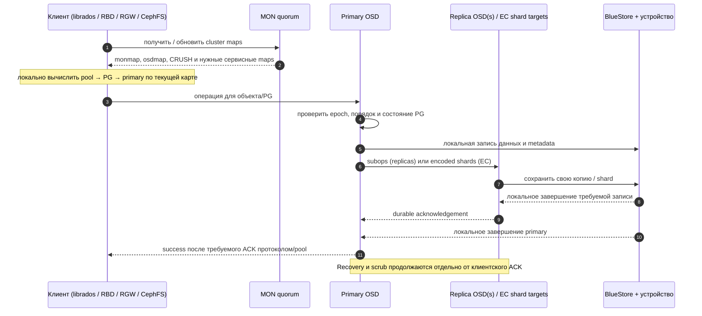

# Deep Dive: Ceph изнутри — RADOS, CRUSH и три интерфейса хранения

Ceph — не «S3-сервер на нескольких дисках» и не единый файловый сервер. Это распределённое объектное ядро RADOS и набор клиентских интерфейсов поверх него: librados, RBD (блочное устройство), RGW (объектный HTTP/S3 API) и CephFS (файловая система). Центральная идея — клиенты и OSD вычисляют размещение данных по общей версии карт кластера; MON согласуют карты и состояние, но не проксируют обычный I/O. Отсюда растут и масштабирование, и цена ошибки в топологии, сети и recovery.

> **Версии.** Архитектурные принципы меняются медленнее, чем CLI, defaults, совместимость клиентов и настройки. Ссылки на `/en/latest/` ведут на актуальную документацию Ceph; сама документация помечает её как development version. Перед изменением production сверяйте страницу с документацией именно установленного upstream-релиза либо downstream-дистрибутива. Отдельные пометки ниже указывают на особенно version-sensitive места.

## 1. Историческая мотивация и современная модель

Ceph возник из исследовательской задачи: построить файловую систему, которая растёт вместе с кластером, переживает обычные отказы устройств и не превращает централизованную таблицу размещения или метаданных в ограничитель всего data plane. В работе OSDI’06 авторы описали RADOS, интеллектуальные OSD и CRUSH: псевдослучайную функцию размещения, позволяющую вычислять местоположение объектов вместо запроса центральной allocation table. Бумага описывает раннюю реализацию и историческую цель; не переносите её детали старого object store/backend на текущий BlueStore. [Ceph: A Scalable, High-Performance Distributed File System (OSDI’06)](https://www.usenix.org/event/osdi06/tech/full_papers/weil/weil.pdf).

Текущая архитектура сохраняет этот принцип, но расширяет интерфейсы: RADOS хранит объекты, а вышележащий сервис задаёт их семантику. Один кластер может одновременно обслуживать блок, файлы и HTTP object API, но это не превращает их в один и тот же контракт: S3 key, RBD image и POSIX inode — разные логические сущности, которые в конечном счёте раскладываются на RADOS-объекты и пулы. [Архитектурная карта Ceph](https://docs.ceph.com/en/latest/architecture/) · [RADOS storage cluster](https://docs.ceph.com/en/latest/architecture/storage-cluster/).

### Слои и ответственность

| Компонент | Ответственность | Чего он не делает |
| --- | --- | --- |
| **MON** (`ceph-mon`) | Согласует версии `monmap`, `osdmap`, `crush map`, `pg map`, `mdsmap` и другие maps; формирует quorum и health state | Не пересылает каждый объектный read/write через себя |
| **MGR** (`ceph-mgr`) | Метрики, dashboard, balancer и orchestration modules | Не является хранилищем байтов пользовательских объектов |
| **OSD** (`ceph-osd`) | Обслуживает локальное устройство, PG, журнал операций, peer replication, peering, recovery/backfill и scrub | Не хранит для всего кластера централизованный индекс «ключ → диск» |
| **RADOS / librados** | Объектная модель, I/O contexts, object operations, xattrs/omap, watches/notifications | Не задаёт само по себе S3 buckets, POSIX namespace или виртуальный диск |
| **RGW** (`radosgw`) | HTTP gateway, S3/Swift-compatible subset, gateway users, bucket/key semantics и их индексы | Не использует MDS и не делает каждый S3 object ровно одним RADOS object |
| **RBD** (`librbd`, kernel client) | Тонко выделяемый блочный образ, striping, snapshots/clones, locks | Не является POSIX filesystem: filesystem поверх RBD создаёт уже клиентская ОС |
| **CephFS MDS** (`ceph-mds`) | Иерархия каталогов/inodes, lease/capability, metadata journal и cache coordination | Не является прокси для содержимого обычных файлов: данные клиенты читают/пишут напрямую в RADOS |

См. [Ceph clients](https://docs.ceph.com/en/latest/architecture/ceph-clients/), [Ceph protocol](https://docs.ceph.com/en/latest/architecture/ceph-protocol/) и [Ceph Storage Cluster APIs](https://docs.ceph.com/en/latest/rados/api/).

## 2. Control plane: MON quorum и карты

Клиент начинает с адреса одного или нескольких MON, получает актуальные карты и затем общается с OSD напрямую. MON держат согласованное представление о составе и топологии кластера. Изменение map проходит через consensus; монитор использует локальный `monmap` для обнаружения peer-мониторов, а не произвольный устаревший `ceph.conf`. Каждый принятый набор изменений получает новую epoch — процессы могут обнаружить, что их локальная view отстала, и обновить её.

Quorum — большинство MON: из 3 нужно 2, из 5 нужно 3. Пять MON не удваивают пропускную способность объектов относительно трёх; они дают больший запас к отказу экземпляров и площадок. Чётный размер сам по себе не обязательно ухудшает quorum, но для одной потери узла 4 MON также требуют 3 голосов и не дают тот же бюджет отказа, что 5. Размещайте MON на независимых host/power/network failure domains, обычно нечётным числом, и не считайте несколько контейнеров на одном физическом хосте независимой HA. [Scalability and High Availability](https://docs.ceph.com/en/latest/architecture/scalability-high-availability/) · [Monitor quorum and common settings](https://docs.ceph.com/en/latest/rados/configuration/common/).

Quorum нужен, чтобы обновлять авторитетные карты и получать согласованное состояние. Если quorum потерян, уже закешированные карты могут дать клиентам некоторую временную работоспособность, но нельзя рассчитывать на устойчивое управление, обновление view и предсказуемое продолжение сервиса. Это control-plane инцидент, а не команда «все байты пропали». При восстановлении мониторов сначала выясняют, какой набор данных и map epochs авторитетен; force-join/пересоздание MON без runbook может закрепить неверное состояние.

### Диагностическая карта

| Map / состояние | Что искать | Безопасное чтение CLI |
| --- | --- | --- |
| `monmap`, quorum | Состав, адреса, leader, epoch, majority | `ceph quorum_status --format json-pretty` · `ceph mon dump` |
| `osdmap` | `up`/`down`, `in`/`out`, pool settings, epoch | `ceph osd dump` · `ceph osd tree` |
| CRUSH map | Вес, иерархия, rules, device classes | `ceph osd crush tree` · `ceph osd crush rule dump <rule>` |
| PG map | `up`/`acting`, `active`, `clean`, degraded и recovery flags | `ceph pg stat` · `ceph pg map <pgid>` · `ceph pg <pgid> query` |
| MDS map | Filesystem, rank, активные и standby MDS | `ceph fs status` · `ceph mds stat` |

## 3. RADOS, OSD и путь вычисления размещения

### Объект, пул, PG, OSD

RADOS — плоское пространство объектов. Логический объект имеет идентификатор, байты и метаданные (включая xattrs; omap даёт объекту key/value metadata). Namespace/pool и объектное имя задают, куда направлять операцию. Семантика полезной нагрузки принадлежит сервису: RGW может хранить object payload отдельно от bucket index, CephFS задаёт file layout, RBD режет logical image на объекты.

**OSD** — daemon для устройства хранения, обычно один `ceph-osd` на диск/устройство. Он участвует в протоколе PG, сохраняет объект в object store, держит историю PG и обслуживает heartbeat, peer traffic и фоновые задачи. Сбой OSD — не обязательно отказ целого host; отказ host обычно одновременно теряет несколько OSD, поэтому устройство только по числу дисков нельзя считать независимым failure domain.

Pool задаёт как минимум назначение/доступ, PG-параметры, CRUSH rule и защитный профиль (`size` либо `k+m`, `min_size`, EC profile). **Placement Group (PG)** — логическая группа объектов, через которую Ceph агрегирует репликацию, журналы, peering, recovery и scrub. PG не является отдельным диском, файлом или постоянно закреплённым сервером. Объекты распределяются по PG хешированием с параметрами пула; CRUSH выбирает набор OSD для PG. Рост числа PG повышает гранулярность балансировки, но увеличивает metadata/CPU/cache расходы; современные кластеры обычно опираются на PG autoscaler и рассчитывают число по всем пулам и OSD, а не назначают старое «магическое» значение каждому пулу.

### CRUSH: одинаковое вычисление, а не центральный каталог

Клиент и OSD используют согласованные cluster maps и CRUSH rules, чтобы получить placement: **object → PG → OSD set**. CRUSH map содержит OSD leaves, веса и topology buckets (`host`, `rack`, `row`, `datacenter` и пр.). Rule может выбрать разные устройства/классы и потребовать разнести replicas по заданному failure domain. При одинаковых карте и параметрах placement вычисляется повторяемо; при изменении карты некоторые PG могут переназначиться. CRUSH спроектирован так, чтобы не перестраивать весь кластер без необходимости, но любая смена rule/weight/device class может создать большой migration, который нужно оценить до apply.

**`up set` и `acting set` — не синонимы.** `up set` — размещение, которое получается по OSD map/CRUSH; `acting set` — OSD, фактически обслуживающие PG в текущей epoch. Во время отказа, remap и recovery наборы могут отличаться. По соглашению первый OSD acting set — **primary**: он координирует write и peering этой PG. [Dynamic Cluster Management](https://docs.ceph.com/en/latest/architecture/dynamic-cluster-management/) · [CRUSH maps](https://docs.ceph.com/en/latest/rados/operations/crush-map/).

```text
S3 key / RBD extent / CephFS file range / librados object
                         │ service-specific mapping
                         ▼
              pool + namespace + object id
                         │ hash + pool PG parameters
                         ▼
                        PG ID
                         │ CRUSH rule + OSD/CRUSH map epoch
                         ▼
          up set ── failure/remap/recovery ──► acting set
                                                │
                                                └─ first member = primary
```

## 4. Peering, durability, replication и EC

### Peering сначала согласует историю

После старта OSD или изменения placement участники PG обмениваются состояниями и журналами, чтобы определить, какая копия/история authoritative и какие операции нужно применить. Peering отвечает на вопрос «можем ли мы безопасно обслуживать PG и с какой историей?», а не «все ли data replicas уже одинаково полны?». PG может завершить peering, оставаться degraded и запускать recovery. `active` означает, что PG может обслуживать допустимый I/O; `clean` означает, что ожидаемое число копий/шардов и объекты восстановлены. Полезные различия при incident: `active+degraded`, `undersized`, `remapped`, `backfill_wait`, `recovery_unfound`, `incomplete`, `stale`.

Для replicated pool `size` — целевое число копий объекта, `min_size` — минимальная доступность копий для I/O. Например, `size=3`, `min_size=2` обычно позволяет продолжить работу при потере одной копии, ценой более низкого запаса к следующему отказу. Не уменьшайте `min_size` в аварии автоматически: можно перевести сервис в режим записи с недостаточным числом копий, который уже не выдержит ожидаемую топологию отказов. Практическое правило для senior: восстанавливайте capacity и возвращайте защиту, а не принимайте «зелёный `ceph -s`» за сохранность данных. [PG monitoring and peering](https://docs.ceph.com/en/latest/rados/operations/monitoring-osd-pg/).

### Репликация и EC

При репликации primary принимает клиентскую запись и раздаёт subops участникам acting set. Успешный ACK означает, что запись прошла требуемый для текущей PG/pool путь подтверждения на OSD, а не просто попала в RAM primary. Документация описывает acknowledgement после persistence на OSD acting set; фактический доступ при деградации ограничен состоянием PG и `min_size`. После ACK дополнительное копирование/repair может ещё оставаться в фоне, если PG работала degraded. Единица упорядочивания — объект/история PG, а не атомарная транзакция через все пулы.

**Erasure coding (EC)** хранит объект в `k` data chunks и `m` coding chunks; сырой коэффициент пространства примерно `(k+m)/k` до учёта metadata и заполнения. В профиле `k=8,m=3` хранится 11 shards и можно восстановить данные при потере до 3 shards, если CRUSH rule и оставшиеся shards действительно удовлетворяют failure policy. Primary кодирует запись в shards и отправляет их OSD. Операция чтения может собрать данные из `k` пригодных shards; потерянные chunks восстанавливаются из остальных.

EC экономит raw capacity на больших, преимущественно последовательных объектах, но усложняет маленькие/random/partial writes: появляются кодирование, чтение-изменение-запись и fan-out. EC pools исторически лучше подходят для full-object writes/append; partial overwrites в RBD/CephFS требуют включить `allow_ec_overwrites` и использовать BlueStore, поскольку глубокая проверка целостности опирается на checksum. EC pool не поддерживает omap; для RBD/CephFS metadata держат отдельно в replicated pool. RGW обычно разделяет data pool и metadata/index pools. Современные EC optimizations зависят от релиза и профиля; не переносите свойства одного workload (например, больших sequential PUT) на random reads. [Erasure Coding](https://docs.ceph.com/en/latest/architecture/erasure-coding/) · [Erasure coding pools](https://docs.ceph.com/en/squid/rados/operations/erasure-code/) · [Pools](https://docs.ceph.com/en/latest/rados/operations/pools/).

## 5. Клиентская маршрутизация и write/read/repair paths

### Data path без MON-proxy

Клиент обращается к MON за картами при подключении и обновляет их после map epoch change. Далее клиентская библиотека вычисляет PG и целевой OSD по локальным картам и направляет I/O напрямую к OSD; OSD primary координирует peers для durability. Так масштабируется путь, а не только фронтенды MON. Это и есть **client-side computation** в Ceph: клиент вычисляет адрес хранения и избавляется от централизованного lookup, но сам по себе он не выполняет репликацию к secondary OSDs и не задаёт файловую/S3-семантику.



**Read:** клиент по актуальной карте адресует объект его PG и пригодный для чтения OSD. Для replicated pools данные могут читаться с primary или с разрешённых конфигурацией replicas; настройки балансировки чтения меняют latency, локальность и нагрузку, поэтому проверяйте конкретный релиз/workload. Для EC требуется получить достаточно shards и декодировать объект. MON обычно не участвует в каждом read. Неполная/устаревшая карта может потребовать обновления и повторной маршрутизации.

**Write:** primary валидирует placement epoch и PG state, создаёт новую версию в истории PG, выполняет локальную запись и subops (replica или EC). Клиент получает success только по ACK-протоколу, после чего обычная запись видна согласно границам RADOS/API. Это не распределённая транзакция между разными объектами: если приложение меняет два ключа, нет автоматического атомарного commit обоих ключей. В librados есть атомарная последовательность операций над одним object, но не меж-PG transaction. [librados API](https://docs.ceph.com/en/latest/rados/api/librados/) · [RADOS client flow](https://docs.ceph.com/en/latest/architecture/ceph-protocol/).

**Repair:** при отказе OSD MON и OSD обновляют cluster view, PG проходит peering, после чего replication/recovery восстанавливает недостающие копии или shards. Если destination set изменился, отсутствует достаточная история PG или нужно наполнить новый OSD, запускается backfill — обход содержимого PG, более дорогой, чем применение известного журнала. Scrub сравнивает состояние объектов/реплик; deep scrub дополнительно читает данные и проверяет checksum. Scrub обнаруживает часть повреждений, но не заменяет резервную копию и не гарантирует исправление, если авторитетной хорошей копии нет. [Recovery и PG states](https://docs.ceph.com/en/latest/rados/operations/monitoring-osd-pg/) · [Health and scrub checks](https://docs.ceph.com/en/latest/rados/operations/health-checks/).

## 6. Внутренности интерфейсов

### librados: интерфейс ядра

`librados` даёт приложениям C/C++/Python и другим bindings прямой API к object, `IoCtx`/pool, асинхронному I/O, xattrs, omap и watch/notify. Он уместен, если приложению естественна объектная модель и оно готово само определить namespace, versioning, индексы, schema evolution, lock/idempotency и compaction. Иначе RGW/RBD/CephFS дают более привычный внешний контракт.

Ниже форма API, схематично, для Python binding из официального librados guide; pool/credentials должны быть заранее настроены, и это **запись в кластер**:

```python
import rados

cluster = rados.Rados(conffile="/etc/ceph/ceph.conf", name="client.app")
cluster.connect()
try:
    ioctx = cluster.open_ioctx("app-data")
    try:
        ioctx.write_full("invoice/2026/00042", b"payload")
        payload = ioctx.read("invoice/2026/00042")
        assert payload == b"payload"
    finally:
        ioctx.close()
finally:
    cluster.shutdown()
```

Пример показывает API shape, а не production credential handling: используйте ограниченного `client.app` с caps только на нужный pool, keyring из защищённого секрета и отдельный идемпотентный namespace. [Introduction to librados](https://docs.ceph.com/en/latest/rados/api/librados-intro/).

### RGW: S3-compatible API поверх RADOS

`radosgw` принимает HTTP, проверяет S3/Swift request signature/ACL/policy и переводит bucket/key операции в набор RADOS объектов и metadata/index operations. S3 object — не обязательно один RADOS object: multipart upload, manifest, metadata и bucket index создают внутреннюю структуру. Поэтому число keys, размер объекта, распределение bucket index shards, resharding и нагрузка на RGW frontends влияют на профиль больше, чем сумма байтов.

«S3-compatible» означает поддержку документированного подмножества API, которое меняется по версии; проверяйте таблицу API features именно вашего Ceph release и реальные операции приложения. Не принимайте совместимость AWS SDK как доказательство идентичности AWS S3 по всем headers, policies, notifications, IAM/STS, encryption и operational behavior. Multi-site zones синхронизируют данные/metadata между **отдельными Ceph clusters**; sync — отдельный путь, обычно асинхронный, и не эквивалентен синхронной межрегиональной транзакции. Не разворачивайте одну RADOS cluster на далёких площадках через latency WAN без специального дизайна. [RGW overview](https://docs.ceph.com/en/latest/radosgw/) · [RGW S3 API compatibility matrix](https://docs.ceph.com/en/latest/radosgw/s3/) · [RGW Multi-Site](https://docs.ceph.com/en/latest/radosgw/multisite/).

Пример boto3 для локальной RGW/S3-compatible endpoint. Credentials передаются через environment variables или секрет-хранилище; URL, регион, signature mode и addressing style проверьте для своего endpoint. Он создаёт bucket и объект — запускайте только на отдельном тестовом endpoint/bucket.

```python
import os
import boto3
from botocore.config import Config

s3 = boto3.client(
    "s3",
    endpoint_url=os.environ["RGW_ENDPOINT"],
    aws_access_key_id=os.environ["RGW_ACCESS_KEY_ID"],
    aws_secret_access_key=os.environ["RGW_SECRET_ACCESS_KEY"],
    region_name=os.getenv("AWS_DEFAULT_REGION", "us-east-1"),
    config=Config(signature_version="s3v4", s3={"addressing_style": "path"}),
)

bucket = "ceph-lab-example"
key = "reports/hello.txt"
s3.create_bucket(Bucket=bucket)
s3.put_object(Bucket=bucket, Key=key, Body=b"hello from RGW\n")
response = s3.get_object(Bucket=bucket, Key=key)
try:
    print(response["Body"].read().decode("utf-8"), end="")
finally:
    response["Body"].close()
```

### RBD: блочный образ как набор объектов

RBD image — логическое адресное пространство блоков, которое раскладывается через striping на RADOS objects в data pool. Kernel RBD client или `librbd` используется, например, QEMU/KVM; файловую систему поверх него видит и обслуживает guest OS. Images thin-provisioned; snapshots и copy-on-write clones позволяют быстро выдавать образы из template, но snapshots/clones не являются отдельной независимой backup-копией. Exclusive locking и watchers защищают координацию writer-ов; потеря/задержка клиента может вызвать blocklisting и восстановление lock state. Metadata pool должен поддерживать требуемые метаданные; для EC data pool нужен replicated metadata pool и разрешённые EC overwrites. [RBD overview](https://docs.ceph.com/en/latest/rbd/) · [RBD snapshots/layering](https://docs.ceph.com/en/latest/rbd/rbd-snapshot/).

### CephFS: файлы, MDS и прямой data I/O

CephFS хранит file data в RADOS data pool, directory/inode metadata — в отдельном metadata pool. MDS ranks управляют иерархией и распределённым cache: выдают клиентам capabilities (caps) и leases, а при конфликте отзывают их, чтобы координировать клиентов. Содержимое обычного файла передаётся клиент ↔ OSD; MDS не сериализует весь file throughput. Metadata mutations агрегируются/journaled в RADOS. Дополнительные active ranks могут распределять metadata load, но не превращают один горячий каталог в бесконечно параллельный workload; MDS cache, directory fanout, client count и caps revoke — отдельные bottlenecks.

Для HA нужны подходящие standby MDS и состояние FS/rank, а не просто «два процесса». Standby принимает отказавший rank и проходит replay/reconnect/rejoin; это может поставить metadata operations на паузу. `max_mds` поднимает число active ranks только при наличии подходящих свободных MDS. CephFS имеет сильную cache coherence между клиентами, но строго POSIX-идентичное поведение во всех кейсах не обещается: одновременно пишущие клиенты, object boundaries и `mmap` имеют документированные ограничения. [CephFS architecture](https://docs.ceph.com/en/latest/cephfs/) · [MDS states](https://docs.ceph.com/en/latest/cephfs/mds-states/) · [CephFS POSIX differences](https://docs.ceph.com/en/latest/cephfs/posix/).

## 7. BlueStore, DB/WAL и классы устройств

BlueStore пишет RADOS objects напрямую на raw block device, минуя локальную filesystem как слой объектов. Устройство OSD связывается с `block`; необязательный быстрый `block.db` выносит RocksDB metadata (в том числе omap и внутренние mappings), а отдельный `block.wal` может вынести metadata write-ahead log. Если DB заполняется, части metadata могут размещаться обратно на основном устройстве: маленький/переполненный DB не делает OSD «быстрее по умолчанию». DB особенно важен для RGW bucket index/omap, metadata-heavy CephFS и быстрых workloads.

**Размеры DB/WAL — version-sensitive.** Текущая upstream-страница рекомендует для offload на fast device планировать `block.db` не менее 2.5% от медленного `block`, а отмечает, что для релизов до Squid (без RocksDB compression) RGW часто требовал более крупный объём — ориентир от 4%; значения зависят от workload, компрессии, object count, layout и версии. Это не универсальная capacity формула. Проектируйте под пиковую metadata и тестируйте заполнение/compaction заранее. Отдельный WAL полезен только когда устройство действительно быстрее основного. BlueStore хранит checksums данных/metadata; scrub использует их для поиска повреждений. [BlueStore config and sizing](https://docs.ceph.com/en/latest/rados/configuration/bluestore-config-ref/) · [BlueStore internals](https://docs.ceph.com/en/latest/dev/bluestore/).

Device class (`hdd`, `ssd`, `nvme`) позволяет CRUSH rules выбрать нужный tier; это свойство OSD topology, а не только «подключили SSD для cache». Создание/переименование class/rule, изменение failure-domain rule или перенос пула может запустить массовый remap/backfill. Перед выбором профиля проверяйте всю rule, OSD tree и фактическое число пригодных устройств в каждом failure domain. [CRUSH device classes](https://docs.ceph.com/en/latest/rados/operations/crush-map/).

## 8. Capacity, сеть и performance tuning

### Capacity и headroom

- Для replication `size=3` — грубый минимум примерно 3 raw bytes на 1 logical byte. Для EC — `(k+m)/k`. Реальная usable capacity ниже: служебные objects, padding, RocksDB/omap, snapshots, object-size distribution и дисбаланс между OSD/rules.
- Планируйте headroom для роста и восстановления **после** отказа самого крупного failure domain. Если почти весь свободный объём сосредоточен на неправильном class/host, он не является пригодной capacity для PG конкретной CRUSH rule.
- `nearfull`, `backfillfull` и `full` — operational guardrails. При полном/почти полном кластере recovery/backfill может заблокироваться, а записи — остановиться; не проектируйте target occupancy около 100%. Считайте capacity worst-case по отказу host/rack, не только по sum(device sizes).
- Сравнивайте raw allocated, logical data, pool `size`/EC profile, per-OSD skew и `MAX AVAIL`; `ceph df` показывает кластерные totals, но может скрыть горячие устройства/пулы.

### Сеть — часть write amplification

Клиент пишет на primary, затем primary раздаёт копии/shards; сеть carry-ит клиентский I/O **плюс** peer replication, heartbeat и recovery/backfill. Поэтому считать только поток клиентских байтов неправильно. Отдельная `public_network`/`cluster_network` может изолировать traffic, но увеличивает сложность/стоимость и не всегда улучшает производительность; при быстрых современных NIC один надёжный network path может быть лучше плохо настроенной двухсетевой схемы. Измеряйте east-west bandwidth, oversubscription, packet loss, tail latency, switch redundancy, bond hashing и client path. Recovery трафик должен укладываться в outage window и не выбивать latency SLO. [Network Configuration Reference](https://docs.ceph.com/en/latest/rados/configuration/network-config-ref/) · [Hardware recommendations](https://docs.ceph.com/en/latest/start/hardware-recommendations/).

### Настраивать по bottleneck, не по folklore

1. Определите SLO и тип I/O: большие sequential writes, small random IOPS, metadata-heavy tree walk, mixed reads, объектные multipart uploads или database volume.
2. Измерьте на end-to-end интерфейсе приложения: concurrency, p50/p99 latency, object/file-size distribution, число keys/inodes, throughput при recovery и после одного host failure.
3. Найдите ограничение по evidence: OSD device latency/utilization, CPU per OSD (replication/EC/compression), memory/cache pressure, RocksDB DB/WAL, PG count/skew, RGW index/frontend, MDS cache/metadata rate, NIC/switch throughput.
4. Меняйте один параметр за раз. Сначала проверьте pool layout, CRUSH failure domains, PG autoscaler/balancer и подходящий replicated/EC policy; затем профиль дисков, DB/WAL, cache и network.
5. Измеряйте steady-state и одновременно simulated failure/recovery load. План, который хорош только при всех OSD `up+in`, не является capacity plan.

PG count, `min_size`, recovery throttles, `osd_memory_target`, scrub windows, EC profile, RGW bucket index shards, MDS cache и kernel client features version-sensitive; фиксируйте release, конфигурацию и workload вместе с benchmark report. Новые defaults/оптимизации релиза могут изменить прежнюю рекомендацию.

## 9. Security, HA, multisite и типовые отказы

### Security и эксплуатация

- CephX аутентифицирует daemon/client и авторизует capabilities; создавайте users по роли и ограничивайте OSD caps конкретными pools/namespaces. Не давайте `client.admin` приложениям. RGW S3 access/secret keys и bucket policies — отдельная граница от CephX credentials.
- Защищайте keyrings/секреты, автоматизируйте rotation по runbook, закрывайте management endpoints, сегментируйте сети и применяйте TLS на публичном RGW endpoint. CephX не заменяет HTTP authentication, IAM policy или защиту ключей.
- Снимайте `ceph -s`, health detail, quorum, OSD tree/df, PG state, per-daemon latency, MDS/RGW telemetry и network metrics. Оповещение «health WARN» — сигнал к разбору причины; краткий WARN во время планового recovery отличается от `stuck`, `incomplete`, `unfound`, `full` или повреждённой MDS metadata.
- RADOS replication и EC защищают от части отказов внутри кластера, но не от operator delete, логической порчи, утраты credentials и общей площадки. Нужны отдельные backup/restore drills и проверенный RPO/RTO. RBD mirroring и RGW multisite — DR-механизмы со своими replication lag/conflict/restore procedures, а не backup сами по себе.
- Высокая доступность состоит из независимых контуров: MON quorum; несколько OSD-host failure domains; свободная capacity под recovery; RGW load-balanced frontends; standby MDS; clients с retry/idempotency; отдельные кластеры и процедуры для DR.

Для RGW Multi-Site realm содержит zonegroups/zones и versioned period; зоны обмениваются metadata и object data. Endpoint health не равен sync completion. Измеряйте lag по shards, проверяйте versioning/conflict semantics конкретного release и тестируйте отказ master zone и восстановление каждой secondary. Современная схема допускает active-active zones, но это не обещает synchronous global consistency. [Multi-Site guide](https://docs.ceph.com/en/latest/radosgw/multisite/).

### Good / bad cases

| Решение | Good case | Bad case / риск |
| --- | --- | --- |
| Репликация `size=3` по `host` | Нужна простая модель отказа диска/хоста, предсказуемые latency и rebuild | Установили 3 replicas в одном failure domain; raw capacity учли как полезную; восстановление не имеет headroom |
| EC на bulk object data | Крупные объекты и capacity важнее записи с минимальной latency | Маленькие random overwrites, слишком мало независимых hosts/racks для `k+m`, metadata случайно направлена в EC pool |
| RGW для аналитических datasets | Приложение использует S3 object semantics и multipart/whole-object IO | Ожидают POSIX rename/locks или полную идентичность AWS без теста используемых API |
| RBD для VM/database volumes | Блоковая семантика, snapshots, thin provisioning, direct QEMU/librbd | Один noisy VM занимает IOPS, array full/latency незаметны до guest outage, snapshot принимают за backup |
| CephFS для общего дерева/HPC | Нужны shared POSIX namespace и согласованная работа клиентов | Много мелких файлов/один горячий каталог без оценки metadata hot spots и размера MDS cache |
| Два private/public network | Recovery traffic действительно забивает клиентский link, а эксплуатация может поддерживать отдельную сеть | Добавили второй network по шаблону, не настроили routing/firewall/monitoring и создали асимметричный отказ |
| Распределённый stretched cluster через WAN | Отдельно спроектирован latency-aware режим и failure policy | Просто растянули обычную CRUSH cluster через географию; round trips и split network делают quorum/peering непредсказуемыми |

## 10. Безопасные CLI-примеры

Все команды ниже — наблюдение/чтение. Выполняйте их с подходящей read-only учётной записью; `ceph -s` по умолчанию часто использует admin keyring. Формат JSON полезен для автоматизации, но schema может меняться между версиями.

```bash
ceph -s
ceph health detail
ceph quorum_status --format json-pretty
ceph mon dump
ceph osd tree
ceph osd df tree
ceph osd dump
ceph osd crush tree
ceph osd crush rule dump <rule-name>
ceph osd pool ls detail
ceph osd pool get <pool-name> all
ceph pg stat
ceph pg map <pool-id>.<pg-hex-id>
ceph pg <pool-id>.<pg-hex-id> query
ceph osd perf
ceph df detail
ceph device ls
ceph versions
ceph balancer status
ceph fs status
ceph mds stat
radosgw-admin sync status
```

Команды состояния не означают, что все операции production-администрации безопасны. Особенно рискованны `pool set`, `osd out/in`, CRUSH edits, `min_size`, `ceph osd set/unset` flags, `pg repair`, `deep-scrub`, `auth caps`, `rados rm`, `rbd snap rollback`, удаление pool и `radosgw-admin realm/period` изменения: они меняют данные/политику, создают нагрузку или раскрывают секреты. Сначала dry-run/impact review по документации своей версии и runbook.

> **Только disposable lab:** следующий пример создаёт pool и объект в тестовом кластере; не выполняйте на рабочем кластере. Выберите заранее отдельный однодневный cluster/namespace, а не production pool.

```bash
# LAB ONLY: создание пула изменяет OSD map и начинает размещать PG.
ceph osd pool create lab-ceph 16
ceph osd pool application enable lab-ceph rados
printf 'ceph lab object\n' > /tmp/ceph-lab-object.txt
rados -p lab-ceph put probe /tmp/ceph-lab-object.txt
rados -p lab-ceph stat probe
rados -p lab-ceph get probe /tmp/ceph-lab-object-copy.txt
cmp /tmp/ceph-lab-object.txt /tmp/ceph-lab-object-copy.txt

# LAB ONLY: удаляет созданный выше объект; проверьте pool и object name.
rados -p lab-ceph rm probe
```

`lab-ceph` оставлен в кластере намеренно: очистка пула — отдельная разрушительная операция. Не копируйте команды, если имя пула уже используется.

## 11. Отказы: что должно насторожить senior

| Симптом | Что это обычно означает | Первый разбор |
| --- | --- | --- |
| `HEALTH_WARN`, `active+degraded` | PG обслуживает I/O с пониженной избыточностью | Найти недоступные OSD/host и оценить запас к следующему отказу; восстановить причину, а не снижать `min_size` наугад |
| `stuck peering` / `incomplete` | Нет согласованной/доступной истории или не хватает участника для безопасного сервиса | `ceph pg <pgid> query`, OSD logs/map epochs; вернуть потенциально содержащие данные OSD прежде чем менять topology |
| `recovery_unfound` / `backfill_unfound` | Ожидаемый объект не найден среди участников | Понять, какой OSD/история могли его содержать; не подтверждать потерю автоматически |
| `backfill_toofull` / `recovery_toofull` | Destination достиг защитного порога либо CRUSH не находит допустимое место | Per-OSD fullness, pool rule/class, failure-domain capacity, худший сценарий отказа |
| Высокий p99 только во время recovery | Recovery competes for disk/network/CPU with client I/O | Посмотреть recovery rate, OSD perf, east-west saturation и latency цели; оценивать window до второго отказа |
| `mon` quorum lost | Недостаточно голосов для нового согласованного control-plane состояния | Проверить сеть/clock/mon logs и сохранность MON stores; не bootstrap/force-join без recovery plan |
| MDS rank failed/damaged | Metadata service не active; повреждение требует operator action | `ceph fs status`, standby availability, MDS journal/health messages; data objects в RADOS не равны доступному POSIX namespace |
| RGW endpoint отвечает, но bucket/object lag есть | Frontend доступен, но zone sync, metadata index или backend PG отстаёт | `radosgw-admin sync status`, RGW logs, shard/realm period, PG health |
| Рост latency на RGW без роста байтов | Горячий bucket index, маленькие objects, omap/DB pressure, resharding или фронтенд | Измерить request distribution, object count/size, DB device и shard skew |
| `ceph df` показывает свободно, pool не пишет | Свободное место суммарно есть, но конкретной CRUSH rule/failure domain не подходит | `ceph osd df tree`, class/topology/rule и PG map; capacity агрегата не всегда доступна данному пулу |

## 12. Альтернативы и границы выбора

Выбирайте по интерфейсу, workload и операционной модели, а не по названию «distributed storage».

| Кандидат | Сильный аргумент для выбора | Проверьте перед заменой Ceph |
| --- | --- | --- |
| **HDFS** | Hadoop-style block/file processing и последовательное чтение больших файлов с compute locality | Namespace/API, small-file cost, HA metadata, replica lifecycle и требуемая object API |
| **Apache Ozone** | Hadoop ecosystem object store/block/file interfaces и масштабирование namespace | Совместимость с конкретным Hadoop/S3 workload, зрелость нужных клиентских интеграций и операционные роли |
| **Lustre** | HPC parallel filesystem с высокой пропускной способностью для научных/compute задач | POSIX metadata/write pattern, storage targets/metadata targets, сеть и обслуживание кластера |
| **SeaweedFS** | Сравнить для более узкого file/blob/S3 совместимого self-hosted сценария | Требуемые RADOS features, repair semantics, metadata/index store, API compatibility и пределы failure domains |
| **RustFS** | Рассмотреть, если задача именно self-hosted S3 endpoint и важны реализация/эксплуатационный footprint | Production maturity, compatibility matrix, data protection/repair, upgrade path и поддержка |
| **Managed object cloud** (например, object service провайдера) | Меньше эксплуатации hardware/control plane и отдельная failure-domain модель провайдера | Egress/latency, quotas, IAM, lifecycle, API differences, residency, lock-in и восстановление из другого аккаунта/региона |

Ceph силён, когда одна операционная платформа нужна для RADOS-native, блочного, файлового и object интерфейсов и организация умеет эксплуатировать recovery/topology. Цена — глубокая ответственность за дизайн failure domains, capacity, сеть, upgrades и client compatibility. Если нужен только один API/паттерн, сравните стоимость владения с более специализированной системой.

## 13. Senior lab и design review

Выполняйте на отдельном disposable test cluster либо в подготовленном учебном окружении. Не симулируйте production failure командами `osd out`, stop/restart OSD или настройками pool без change plan. Цель лабораторной — доказать reasoning и наблюдаемость, а не «проверить, сломав кластер».

### Лабораторный маршрут

1. Зафиксируйте версию и baseline: `ceph versions`, `ceph -s`, `ceph quorum_status`, `ceph osd tree`, `ceph df detail`, `ceph pg stat`.
2. Нарисуйте топологию CRUSH и объясните pool rule, failure domain, device class, `size`/`min_size`, EC profile, autoscaler и headroom. Назовите конкретный host/rack failure и рассчитайте оставшуюся пригодную capacity.
3. Используйте только pool `lab-ceph`, созданный в изолированном кластере. Запишите объект через `rados`, затем найдите PG (`ceph osd map lab-ceph probe`), проверьте mapping, `pg map/query` и прочитайте объект обратно. Сопоставьте output `acting`/`up` с CRUSH tree.
4. Если sandbox заранее подготовлен ментором с 3+ независимыми OSD hosts, продемонстрируйте запланированный отказ одного OSD/host через безопасный lab runbook. Следите за PG state, recovery/backfill, per-OSD fullness/latency и клиентской ошибкой/latency; зафиксируйте состояние до/во время/после. Не вводите `noout`, `min_size` или forced recovery без цели и команды восстановления.
5. Для RGW отправьте тестовый объект через boto3, сравните API request/error/ETag и состояние RGW/PG; отдельно объясните, почему S3 object не тождествен одному RADOS object. Для CephFS/RBD сравните, какая metadata path у каждого интерфейса.
6. После упражнения проверьте, что PG вернулись к `active+clean`, quorum цел, нет flags, временных credentials не осталось; удалите только lab object по его точному имени. Если был создан test pool, удаляйте его только отдельным разрешённым cleanup runbook.

### Вопросы дизайн-ревью

1. Каковы RPO/RTO и допустимые p99 для обычного режима, потери одного OSD, host, rack, switch и целого сайта?
2. Что происходит, если все replicas/shards одной PG оказались в одном физическом failure domain? Какая проверка карты это заметит заранее?
3. Для `size=3` и для `k=8,m=3` какой объём raw capacity, сколько failure domains требуется, какой worst-case rebuild и где взять свободное место?
4. Достаточна ли семантика API? Нужны ли atomic multi-object transaction, rename, locking, versioning, retention, notifications, range reads или только whole-object IO?
5. Какая доля metadata (RGW bucket index, CephFS inode/directory, RBD metadata) и какова hot-key/large-directory distribution? Хватит ли DB/WAL и MDS/RGW CPU/RAM при восстановлении?
6. Как обновляются clients/monitors/OSDs между версиями? Какие features/pool flags/RBD image features/S3 APIs являются compatibility boundary?
7. Как защищены CephX и S3 credentials, как ограничены caps, какие сети доступны извне, что шифруется на каждом hop?
8. Где находится backup, кто и как доказывает restore, как обнаруживается latent corruption, как сверяются cross-site copies и каков фактический replication lag?
9. Какой health/PG/MDS/RGW/OSD/network сигнал переведёт on-call с «наблюдать» на «принимать решение», и у кого полномочия на изменение pool/CRUSH?
10. Как меняется решение, если вместо единой Ceph платформы выбрать HDFS/Ozone/Lustre/SeaweedFS/RustFS или managed object service?

## Источники и что сверять по release

Все ссылки ниже ведут на первичные материалы Ceph или оригинальную Ceph paper. Страницы `/en/latest/` могут описывать development branch, а страница Squid приведена как пример release-specific документации.

- История и исходная архитектура: [OSDI’06 Ceph paper](https://www.usenix.org/event/osdi06/tech/full_papers/weil/weil.pdf).
- Слои, cluster maps, clients, протокол: [Architecture](https://docs.ceph.com/en/latest/architecture/) · [RADOS cluster](https://docs.ceph.com/en/latest/architecture/storage-cluster/) · [Ceph clients](https://docs.ceph.com/en/latest/architecture/ceph-clients/) · [Ceph protocol](https://docs.ceph.com/en/latest/architecture/ceph-protocol/) · [librados](https://docs.ceph.com/en/latest/rados/api/librados-intro/).
- Quorum, maps, CRUSH, PG/peering: [HA and maps](https://docs.ceph.com/en/latest/architecture/scalability-high-availability/) · [Dynamic cluster management](https://docs.ceph.com/en/latest/architecture/dynamic-cluster-management/) · [CRUSH map](https://docs.ceph.com/en/latest/rados/operations/crush-map/) · [PG monitoring](https://docs.ceph.com/en/latest/rados/operations/monitoring-osd-pg/) · [health checks](https://docs.ceph.com/en/latest/rados/operations/health-checks/).
- EC, BlueStore и сеть: [EC overview](https://docs.ceph.com/en/latest/architecture/erasure-coding/) · [Squid EC guide](https://docs.ceph.com/en/squid/rados/operations/erasure-code/) · [pools](https://docs.ceph.com/en/latest/rados/operations/pools/) · [BlueStore config](https://docs.ceph.com/en/latest/rados/configuration/bluestore-config-ref/) · [network config](https://docs.ceph.com/en/latest/rados/configuration/network-config-ref/) · [hardware recommendations](https://docs.ceph.com/en/latest/start/hardware-recommendations/).
- Верхние интерфейсы и защита: [RGW](https://docs.ceph.com/en/latest/radosgw/) · [S3 compatibility](https://docs.ceph.com/en/latest/radosgw/s3/) · [RGW multisite](https://docs.ceph.com/en/latest/radosgw/multisite/) · [RBD](https://docs.ceph.com/en/latest/rbd/) · [CephFS](https://docs.ceph.com/en/latest/cephfs/) · [MDS states](https://docs.ceph.com/en/latest/cephfs/mds-states/) · [CephX user management](https://docs.ceph.com/en/latest/rados/operations/user-management/).

**Особенно version-sensitive:** S3 feature support; RGW multisite sync policy/period; RBD image features и kernel compatibility; EC partial overwrites/optimizations; PG autoscaler and balancer behavior; BlueStore RocksDB/compression/cache sizing; MDS/cephadm lifecycle; CLI output и допустимые commands. Перед production change откройте те же разделы для кластера установленного release и проверьте release notes.
