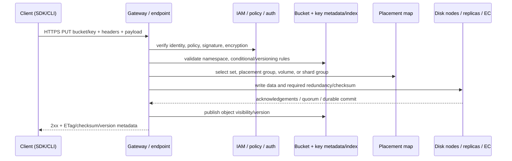
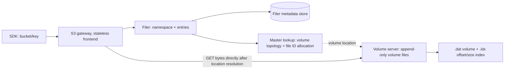

# Deep Dive: от storage идеи к размещённому на диске байту

Уровень: **Senior** · Предпосылки: TCP/IP, filesystem basics, replication, Hadoop/Spark. Цель — научиться читать storage architecture по request path и failure mode, а не по названию продукта.

## 1. Мотивация: почему локального диска и NFS стало мало

Storage API кодирует компромисс. Локальный блочный диск удобен для произвольных обновлений и малых random I/O, но ограничен машиной и часто не разделяется конкурентно. NFS/SMB дают привычную файловую модель и central namespace, однако metadata сервер, locks, directory traversal и network latency входят в путь многих операций. Крупная data processing система должна хранить больше, чем один узел, переживать обычные дисковые/серверные отказы и кормить множество вычислителей одновременно.

### Исторические развилки

| Год/эпоха | Сдвиг | Системная причина и цена |
| --- | --- | --- |
| До scale-out систем | DAS, RAID, SAN, NFS/SMB | зрелые file/block semantics; масштаб/HA/сеть требуют дорогого или сложного центрального оборудования |
| 2003 — GFS paper | большие файлы, много клиентов, дешёвые commodity servers, обычные ошибки как нормальный режим | централизованная metadata coordination + replicated chunks + высокопроизводительные последовательные reads/writes; компромисс не в пользу POSIX workloads |
| 2000-е — HDFS/Hadoop | GFS-идеи доступны open-source data processing | блоки и namespace на NameNode, streaming access, replica placement, compute locality; small files и namespace memory становятся критичны |
| 2006 — Ceph paper и Amazon S3 launch | динамический cluster с intelligent OSD placement; HTTP доступ к elastic object storage | отделение имени/metadata от bytes; S3 делает API доступным удалённым compute, но клиент принимает object-level semantics |
| 2010 — Facebook Haystack paper | много маленьких фото, long-tail reads, слишком много metadata lookups в NFS/NAS пути | специализированный object store снижает metadata disk operations; tradeoff делается под конкретный read-mostly workload |
| 2010-е — cloud data lakes | compute и storage масштабируются независимо | lifecycle, classes, IAM, cross-region и дешёвое хранение; добавляются request/egress cost и переменная сеть |
| Lakehouse era | table formats поверх object stores | S3 сам по себе не транзакционная таблица; manifests/snapshots/catalog добавляют snapshot isolation и атомарную публикацию состояния |

Источники: [GFS, SOSP 2003](https://research.google/pubs/the-google-file-system/), [HDFS Architecture](https://hadoop.apache.org/docs/stable/hadoop-project-dist/hadoop-hdfs/HdfsDesign.html), [Ceph, OSDI 2006](https://www.usenix.org/legacy/event/osdi06/tech/full_papers/weil/weil_html/index.html), [Amazon S3 launch date](https://aws.amazon.com/blogs/aws/eight-years-and-counting-of-cloud-computing/).

Важно: object-storage идеи и object-based devices предшествовали S3. Историческая роль Amazon S3 здесь — сделать HTTP bucket/key service широко доступным как управляемую cloud-платформу, а не «изобрести объекты». К 2010 году Haystack показывал другой характерный путь: для photo workload NFS-based NAS делал слишком много metadata disk operations, а специализированный object store оптимизировал размещение и in-memory lookup. [Haystack, OSDI 2010](https://www.usenix.org/conference/osdi10/finding-needle-haystack-facebooks-photo-storage).

Дизайн — следствие workload. В GFS статье зафиксированы appends/large files, высокая aggregate throughput, тысячи обычных машин и component failures. HDFS явно оптимизирует large datasets, streaming access, write-once/read-many и размещение computation рядом с данными. Не переносить их оптимизации на образ диска, SQLite WAL или низколатентный key-value store без измерений.

## 2. Четыре уровня, которые нельзя смешивать

```text
Application contract        path/open/lock  |  bucket/key/HTTP  |  block device
Namespace / metadata         inode + dirs   |  object index     |  logical-to-physical map
Placement / fault handling   chunk replicas |  CRUSH / EC / replicas / placement service
Physical bytes                SSD/HDD/NVMe/network, checksum, cache, filesystem, controller
```

Один физический disk array может экспортироваться как block volume, file share и object endpoint, но это не значит, что поверх них одинаковы rename, read-after-write, locking, versioning, conditional writes, failover или billing. Совместимость с S3 — совместимость некоторого множества HTTP operations; не доказательство совпадения API extensions, auth, versioning, multipart, conditional writes, bucket semantics, consistency и recovery behavior.

### Block, file, object contract

| Операция | Block | File | Object |
| --- | --- | --- | --- |
| Address | LBA/offset | path + file handle/inode | bucket + key + optional version ID |
| Read/write | байтовый диапазон с произвольным offset | open/read/write/append, filesystem metadata | GET / range GET / PUT нового содержимого / multipart |
| Rename | клиентскому FS не виден rename блока | namespace operation; атомарность зависит от сервиса и границы операции | обычно copy+delete либо server-side rename extension; key не превращается в directory transaction |
| Согласование | filesystem/DB на клиенте и block coordination | locks, leases, cache invalidation, namespace semantics | сервисный contract по key; multi-key transaction нужно строить отдельно |
| Хорошо подходит | VM/DB volume, random I/O | shared workspace, home directories, applications that require paths | archive, data lake, media, backups, lakehouse files, immutable blobs |
| Типичный провал | разделяемый mount поверх одного writable FS без cluster FS | миллиарды крошечных metadata ops через перегруженный metadata tier | высокочастотное in-place overwrite/locking и клиент, который ожидает local POSIX |

Объект — не обязательно immutable по ключу. Клиент может отправить новый PUT на тот же key; сервис определяет атомарность одного ключа, версии и конкурентные записи. Но API обычно не предлагает произвольный write offset и multi-key transaction. Например, Amazon S3 документирует strong read-after-write для object PUT/DELETE и атомарную видимость одного key; при одновременных PUT на key действует last-writer-wins, а атомарного обновления нескольких keys нет. У другого S3-compatible хранилища это нужно проверить отдельно. [AWS S3 consistency contract](https://docs.aws.amazon.com/AmazonS3/latest/userguide/Welcome.html)

## 3. Общий S3/object request path



Это conceptual request path, не утверждение об internals Amazon S3. Managed cloud provider скрывает физические узлы. В self-hosted Ceph/SeaweedFS/MinIO администратор может увидеть части topology, quorum, disks и repair. Критический вопрос для клиента: что означает successful response — принятый gateway buffer, записанные shards, подтверждённый replica quorum или durable sync? Ответ зависит от продукта, конфигурации, topology и API operation.

### Multipart upload и «атомарность объекта»

Большой S3 object может передаваться как multipart: initiate → upload parts параллельно/с retry → complete. Получатель не должен воспринимать незавершённые parts как committed object; complete публикует результат операции согласно реализации сервиса. Multipart повышает throughput и позволяет повторять только неуспешные parts, но оставляет orphaned uploads, если клиент не завершил/не отменил загрузку; нужен lifecycle cleanup. ETag не следует универсально трактовать как MD5: multipart и серверная реализация могут задавать иное значение. Для проверки bytes используй документированные checksum fields / checksum APIs, не бизнес-предположение об ETag. [AWS S3 integrity checks](https://docs.aws.amazon.com/AmazonS3/latest/userguide/checking-object-integrity.html)

### Python: S3 SDK — объектный контракт

```python
import os
import boto3

s3 = boto3.client(
    "s3",
    endpoint_url=os.environ.get("S3_ENDPOINT", "http://localhost:19000"),
    region_name=os.environ.get("AWS_DEFAULT_REGION", "us-east-1"),
    # В лаборатории credentials берутся из Compose environment.
    # В cloud используй workload identity/role, не вшивай key в код.
)

bucket = "de-mentor-warehouse"
key = "storage-lesson/example.txt"
s3.put_object(Bucket=bucket, Key=key, Body=b"immutable example bytes\n")
metadata = s3.head_object(Bucket=bucket, Key=key)
print(metadata["ContentLength"], metadata.get("VersionId"))

response = s3.get_object(Bucket=bucket, Key=key, Range="bytes=0-7")
try:
    print(response["Body"].read())
finally:
    response["Body"].close()
```

Повторный `put_object` на тот же key заменяет содержимое согласно semantics endpoint-а; это не random update первых 8 bytes. `Range` запрашивает часть уже опубликованного объекта. Перенеси credentials и endpoint в конфигурацию, а не код. На host endpoint будет `http://localhost:19000`; внутри Compose network установи `S3_ENDPOINT=http://seaweedfs:8333`. Boto3 нужно установить в изолированную учебную среду, если хочешь повторить именно Python.

Flat namespace не означает, что `ListObjects(prefix=...)` бесплатен. Это metadata operation: объем работы зависит от числа ключей/страниц, partitions и индекса реализации. Папки, показанные UI, часто вычисляются из common prefixes. Для тысяч/миллионов keys, горячих prefixes, массовых deletes и `LIST` — benchmark и design key distribution являются частью проекта.

## 4. Репликация и erasure coding

### Replication

Хранить `r` полных копий просто объяснить, обычно просто читать и восстанавливать. При `r=3` nominal raw-space overhead равен `3x`, до metadata, free reserve, compaction и repair. Replica должны располагаться по failure domains, иначе 3 копии в одном rack не переживают rack loss. Размещение учитывает host/rack/zone, media class, write quorum и anti-affinity.

Write latency часто примерно равна latency выбранного acknowledgement policy, а не всех возможных резервных копий. В одних системах клиент получает ack после синхронного replica quorum, в других часть копий догоняет асинхронно. Читай фактический write acknowledgment contract; availability избыточности зависит от разделения сети, срока деградации и поведения recovery.

### Erasure coding

В MDS/ Reed–Solomon-подобной схеме исходный stripe делится на `k` data shards и `m` parity shards (`n=k+m`). Условная storage efficiency `k/n`; raw-space overhead `n/k`. `8+3` даёт `11/8 = 1.375x` и может восстановить исходный stripe при потере до 3 независимых shards. «Трёх отказов» недостаточно сказать для SLO: важно, что такое shard, куда он размещён, какие узлы отказали одновременно и осталось ли достаточно доступных shards для read/write quorum.

Цена: при read/repair часто нужно параллельно прочитать несколько shards; реконструкция потребляет CPU, network и bandwidth disks. Маленький object может быть padded или помещён специальным способом; небольшие writes могут попадать в write amplification. Географический EC stripe увеличивает write latency и сложности при потере зоны. Replicas часто предпочтительнее для горячего небольшого metadata / малых файлов; EC — для больших холодных объектов с достаточной шириной полосы и высокой utilization. Это гипотеза для benchmark, не закон.

Ceph задаёт failure domain и device class через CRUSH rules для replicated и erasure-coded pools; EC pool хранит data и coding chunks на OSD, а primary OSD обслуживает операции и authoritative PG log. MinIO AIStor описывает объект как data/parity shards в erasure set; read/write quorum и parity настройки влияют на поведение при outage. Проверяй реализацию, документацию используемой редакции и version. [Ceph CRUSH](https://docs.ceph.com/en/latest/rados/operations/crush-map/) · [Ceph EC](https://docs.ceph.com/en/latest/architecture/erasure-coding/) · [MinIO AIStor EC](https://docs.min.io/aistor/operations/core-concepts/erasure-coding/).

### Сравнение в формулах

```text
replicas r:       raw bytes ≈ D × r             nominal overhead = r
EC (k,m):         raw bytes ≈ D × (k+m)/k       nominal overhead = (k+m)/k
usable capacity:  raw bytes × efficiency − reserved free space − metadata/temporary headroom
```

Нельзя заполнять cluster до 100% расчетной usable capacity. Repair, rebalance, compaction и rebuild требуют свободного места и полосы; capacity pressure превращает потерю устройства в затяжной период пониженной избыточности. Считай acceptance target на время выхода из худшего отказа и оставляй операционный reserve.

## 5. HDFS: централизованный namespace, распределённый block data path

### Контракт и роли

HDFS рассчитан на большие datasets и high-throughput streaming access; традиционный профиль — крупные файлы, write-once/read-many, обработка рядом с data nodes. NameNode ведёт namespace и mapping file → blocks → DataNodes. DataNodes держат block bytes и отчитываются heartbeats/block reports; NameNode решает placement/replication, но client передаёт bytes напрямую в DataNode pipeline. Namespace и block mapping в NameNode — архитектурная мощность и ограничение: metadata memory/операции могут стать bottleneck независимо от свободных disk bytes.

HDFS namespace не равен универсальному S3 object API. Он поддерживает пути и rename в файловом namespace, но append/write semantics и concurrency ограничены. Точные атомарные границы нужно читать в Hadoop version и используемом client.

### Write path, replication factor 3

```text
1. client -> NameNode: create(path)
2. NameNode: проверка permission/namespace; возврат списка DataNodes для block
3. client -> DN1 -> DN2 -> DN3: поток data packets и checksums
4. DN3 -> DN2 -> DN1 -> client: ack chain, packet/block status
5. client -> NameNode: complete(file); namespace commit
6. DataNodes -> NameNode: heartbeat + block report; при нехватке copies идёт re-replication
```

Точная цепочка зависит от pipeline recovery, packet acknowledgements, block allocation и протокола версии. Важный концепт: control plane выбирает и координирует, data plane потоково передаёт bytes; NameNode не становится proxy всего dataset. Rack awareness определяет replica placement; при исчезновении node NameNode считает block under-replicated и запускает repair. [HDFS design](https://hadoop.apache.org/docs/stable/hadoop-project-dist/hadoop-hdfs/HdfsDesign.html)

### Java API: путь через HDFS client

```java
import java.net.URI;
import java.nio.charset.StandardCharsets;
import org.apache.hadoop.conf.Configuration;
import org.apache.hadoop.fs.FSDataOutputStream;
import org.apache.hadoop.fs.FileSystem;
import org.apache.hadoop.fs.Path;

Configuration conf = new Configuration();
URI namenode = URI.create("hdfs://namenode:8020");
Path path = new Path("/training/probe.bin");
byte[] payload = "hello from HDFS\n".getBytes(StandardCharsets.UTF_8);

try (FileSystem fs = FileSystem.get(namenode, conf);
     FSDataOutputStream out = fs.create(path, false, 64 * 1024,
                                       (short) 3, 128L * 1024 * 1024)) {
    out.write(payload);
}
```

Hadoop client взаимодействует с NameNode для namespace/block allocation, затем пишет поток в DataNode pipeline. Конкретные defaults и API signatures привязаны к Hadoop release. `false` означает не перезаписывать уже существующий path; replication factor здесь задаётся при создании файла. Код не даёт приложению права обходить DataNode pipeline и не означает, что NameNode принимает payload.

### Где HDFS силён и где тяжело

Силен: низкая стоимость/байт на собственном cluster, throughput scan, native Hadoop compute locality, файловое namespace и понятные block replicas. Тяжелее: NameNode namespace size, мелкие файлы и создание/listing, mutable low-latency random access, multi-tenant cloud-style access, elasticity и maintenance/Hadoop expertise. Federation shards namespace across NameNodes; HA uses active/standby NameNode and shared edits coordination, но это добавляет failure/operations story, а не отменяет capacity planning.

Для современного cloud lakehouse object store часто отделяет storage lifetime от compute cluster и даёт более естественный cross-engine access. HDFS по-прежнему полезен в закрытых Hadoop environments, on-prem compute locality и местах, где file semantics/throughput дают преимущество. Не выбирай его только потому, что Spark умеет читать `hdfs://`.

## 6. Ceph: RADOS как общий substrate для object, block и file

### Основная идея

Ceph отделяет интерфейсы от базового распределённого object store RADOS. OSD daemon хранит objects, обрабатывает replication/EC, peering и recovery; Monitor quorum поддерживает authoritative cluster maps и configuration; Manager предоставляет management/metrics. CRUSH использует cluster map и policy, чтобы клиент вычислил placement, уменьшая централизованный per-object directory lookup и дорогое полное перемещение данных при добавлении узлов. Детали client protocol и map versions зависят от Ceph release.

```text
RBD block client ─┐
CephFS client ────┼── librados/RADOS ── CRUSH rule ── PG ── OSDs
RGW S3/Swift ─────┘           │              │         └─ replica / EC shards
                            MON map        placement groups
```

CephFS добавляет MDS для directory/inode metadata, RBD предоставляет block devices, RGW — HTTP S3/Swift gateway. Все три интерфейса используют один Ceph storage cluster, что уникально удобно для общего on-prem substrate. Но «один кластер» означает взаимное влияние по CPU, network, disks, memory, placement groups, recovery traffic и operations; isolation/capacity governance нужно проектировать.

### CRUSH и recovery

CRUSH rule описывает root, device class, replication/EC policy и failure domain. Клиент/daemon применяет deterministic placement по cluster map, затем действует placement group protocol: peering находит authoritative version, primary сериализует операции PG, OSDs выполняют локальную обработку и ack. При изменении map только затронутые placement groups должны переместить/переупорядочить данные, а не всё пространство. Это сокращает metadata bottleneck ценой cluster map logic, PG state machines и фоновых операций.

Не путай PG (управляемая группа объектов, protocol/recovery unit) с физическим диском или одним object. Монитор quorum — не data replica. У кластера отдельные состояния: MON quorum, OSD up/in, PG active/clean/degraded, backfill, scrub. На workload влияют размеры pools/PGs, network topology, recovery priority, DB/WAL devices, device class, kernel/network stack. В production решение требует измерения и чтения release-specific tuning guide.

Ceph силён, когда нужны RADOS API + RBD + CephFS + RGW на одном гибком on-prem/private-cloud substrate, multi-vendor hardware и собственная политика failure domains. Он сложнее в развертывании/upgrade и требует специалистов, свободного reserve capacity и recovery budgeting; сложный RADOS cluster не нужно выбирать лишь ради локального `aws --endpoint-url`.

Источники: [Ceph architecture](https://docs.ceph.com/en/latest/architecture/), [CRUSH map rules](https://docs.ceph.com/en/latest/rados/operations/crush-map/), [RGW](https://docs.ceph.com/en/latest/radosgw/), [CephFS architecture](https://docs.ceph.com/en/quincy/cephfs/index.html), [OSDI paper](https://www.usenix.org/legacy/event/osdi06/tech/full_papers/weil/weil_html/index.html).

## 7. SeaweedFS: отделить blob volume от directory metadata

SeaweedFS ориентирован на очень большое количество файлов/blob-ов и быстрый доступ. Конкретный request path зависит от того, используется ли S3 gateway, Filer API, FUSE или table catalog; это не один монолитный POSIX filesystem.



### Blob path

1. Master tracks volume locations/topology and allocates file IDs; data file payloads do not all pass through master.
2. Volume server stores many blobs within larger volume files; index maps file key to offset/size. Appending content avoids a random metadata update for every small blob; deleted/stale entries require compaction/vacuum to reclaim space.
3. Filer stores path namespace/entry metadata in a chosen backend; it can expose HTTP, S3, WebDAV, SFTP or FUSE. The metadata backend is a distinct durability/backup concern from volume disks.
4. S3 gateway maps bucket/key and S3 API semantics to Filer/storage. Gateways can scale separately in a multi-service deployment.
5. Replication/tiering and volume-level erasure coding/repair are separate admin operations and policies. Placement labels/replication behavior must be validated against topology, release and failure domain.

Official current README describes a master/Raft group, volume servers with append-only volume files and a compact per-blob in-memory index, filer metadata backend options and gateway protocols. [SeaweedFS architecture](https://github.com/seaweedfs/seaweedfs/blob/master/README.md) · [REST surfaces](https://github.com/seaweedfs/seaweedfs/blob/master/REST_API.md) · [S3 gateway mapping](https://github.com/seaweedfs/seaweedfs/wiki/Amazon-S3-API).

### Why it is distinct

Master indexes **volumes**, not all individual files. This lowers master metadata footprint for high file cardinality. Append-only blob writes and volume compaction trade simple append path for stale space reclamation and background housekeeping. Filer metadata can use several backends; this makes namespace a separately sized/backup-managed component. S3 gateway is stateless-ish and maps object operations to filer. Multiple client protocols over shared data reduce duplication but do not make every protocol's locking/rename/consistency contract identical.

### What to validate before production

- Production topology separates master quorum, volume servers/disks, filer metadata database, S3 gateways, admin/maintenance workers and monitoring. The local lesson Compose co-locates components and is not representative.
- Protect all component RPC ports with network policy and security config; publish only intended HTTPS endpoints. Filer metadata database, S3 IAM, TLS/mTLS, credentials and backup/restore are first-class components.
- Read current release advisories before deployment. The local Compose image is pinned; it is loopback-only and carries demo credentials. Do not expose its ports or infer a production security posture from a successful lab.
- Security-review example: upstream published [GHSA-5fx4-c9qp-36jc](https://github.com/seaweedfs/seaweedfs/security/advisories/GHSA-5fx4-c9qp-36jc) on 2026-09-18 for unauthenticated S3 gateway gRPC identity-management calls; the page's affected/patched range can change. Compare the exact pinned build (this course lab uses 4.46), advisory status and reachable gRPC endpoints before exposure. This note is a prompt to verify the current advisory, not a claim that a given tag is affected or fixed.
- Test repair/rebalance/compaction on representative object size distribution. Verify whether adding a volume server automatically changes placement or requires explicit balancing; in SeaweedFS placement changes may depend on operator action and release tooling.
- Measure metadata DB latency, filer CPU, gateway saturation, master lookup latency, volume disk queue depth, repair bytes and low-capacity behavior separately.

## 8. Metadata, small objects and directory listings

There are several different metadata workloads:

1. **Namespace**: path, parent, permissions, mtime, file size; relevant to HDFS NameNode, CephFS MDS, SeaweedFS Filer and NFS.
2. **Object index**: key, version, tags, retention, lifecycle, bucket policy; relevant to S3 control/data plane.
3. **Placement metadata**: object/block → disk/node/rack; HDFS block map, Ceph cluster map/PG, SeaweedFS volume map.
4. **Table metadata**: Iceberg snapshots/manifests; above storage API and not identical to object-service metadata.

Ten million objects of 10 KB contain only ~100 GB payload, but may carry costly index entries, open/close/list operations, checksums, request overhead and compaction pressure. Millions of tiny Parquet files also create Iceberg manifests, planning cost, slow scans and small I/O; solve with batching/rolling/compaction before adding more object storage. Conversely, making objects enormous harms selective range reads, parallelism, retry granularity and lifecycle flexibility.

Benchmark at real object-size distribution and skew: GET/PUT mix, sequential/range reads, prefix scan, concurrency, p50/p95/p99, retry rate, client cold start, in-flight multipart, small-file listing, GC, repair under degraded capacity. Average MB/s alone hides metadata and tail-latency bottlenecks.

## 9. Consistency, atomicity and lakehouse layers

Keep guarantees in separate boxes:

```text
S3 service:          one object key / version / request guarantees
Iceberg table:       snapshot + manifest + optimistic commit through catalog
Flink sink:          checkpoint + writer committables + sink commit/recovery
Business semantics:  deduplication key, event-time rules, external side effects
```

Strong consistency of a provider's GET/PUT/LIST does not make several keys one transaction. Iceberg uses immutable data/manifest files and publishes current table metadata via a catalog commit. Flink checkpoint recovery governs operator state and source positions, and the sink integrates file publication with checkpoint semantics. A stronger storage PUT cannot replace either Iceberg commit coordination or Flink checkpointing.

When using a mounted S3 filesystem adapter, understand its cache, rename/copy-delete, write buffering, locking, listing, fsync and crash behavior. An adapter gives a filesystem-shaped client API, not necessarily POSIX semantics or database-quality latency.

## 10. Failure matrix: ask what is lost and what can be rebuilt

| Failure | Availability question | Correctness/recovery question |
| --- | --- | --- |
| Single disk / node | Is there a readable quorum / replica? | Are checksums detected? Can rebuild bandwidth keep up? |
| Rack / AZ | Were shards spread across it? | Does EC stripe survive correlated loss? Is write quorum available? |
| Metadata service | Can cached placements serve reads? | Is namespace/catalog metadata durable and recoverable? |
| Gateway / load balancer | Are there other endpoints? | Can clients safely retry idempotent requests? Multipart abort? |
| Network partition | Which side accepts writes? | How are concurrent updates resolved? |
| Region outage | Is replica/backup independent? | Is the failover RPO compatible with async replication lag? |
| Operator mistake / ransomware | Do versioning/retention help? | Are credentials, object lock, backup and restore separated? |

Availability, durability and recoverability differ. Replication may keep reads available but not save from replicated accidental deletes. Versioning may preserve old keys but not clean permission metadata. Backup is only proven after restore in an isolated target. Storage repair is not a substitute for backup or application-level reconciliation.

## 11. Senior review prompts

1. If all data bytes are healthy but the namespace DB is gone, can clients find the files?
2. Does a successful write response guarantee one copy, quorum, or durable state according to docs?
3. Which single failure domain could remove more than `m` shards of an EC stripe?
4. Who is allowed to repair/compact/rebalance, how is its progress throttled, and what prevents it from saturating production traffic?
5. Is object identity immutable/content-addressed or mutable/key-addressed? How are concurrent updates resolved?
6. What is measured in an S3 compatibility PoC besides `PutObject` and `GetObject`?
7. What is the migration reversal plan if request pricing or endpoint semantics fail the business case?
