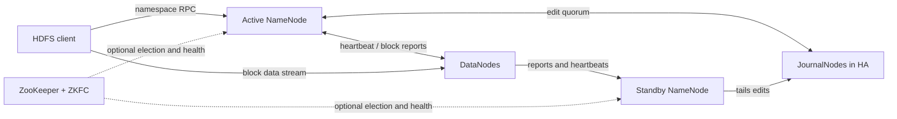
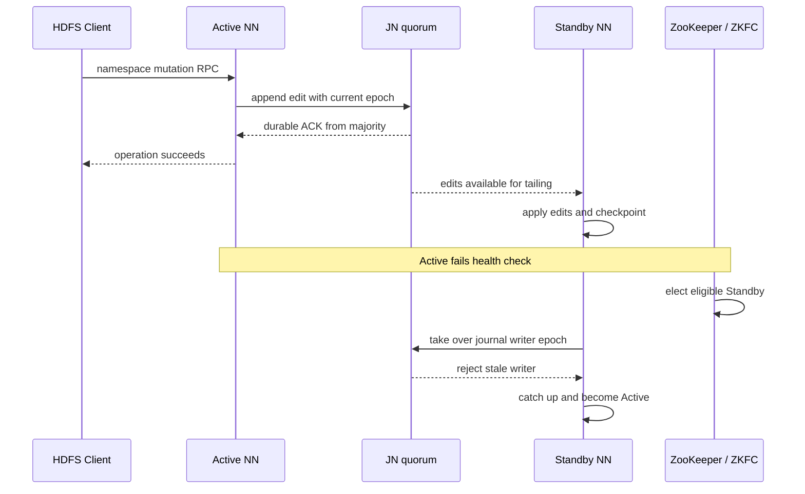
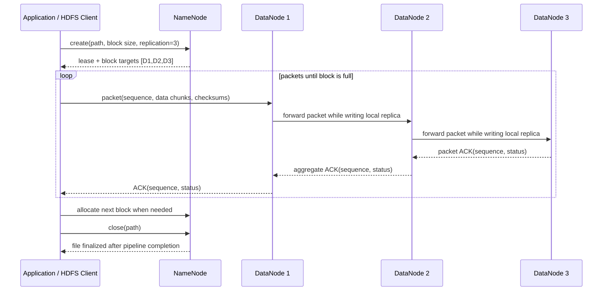
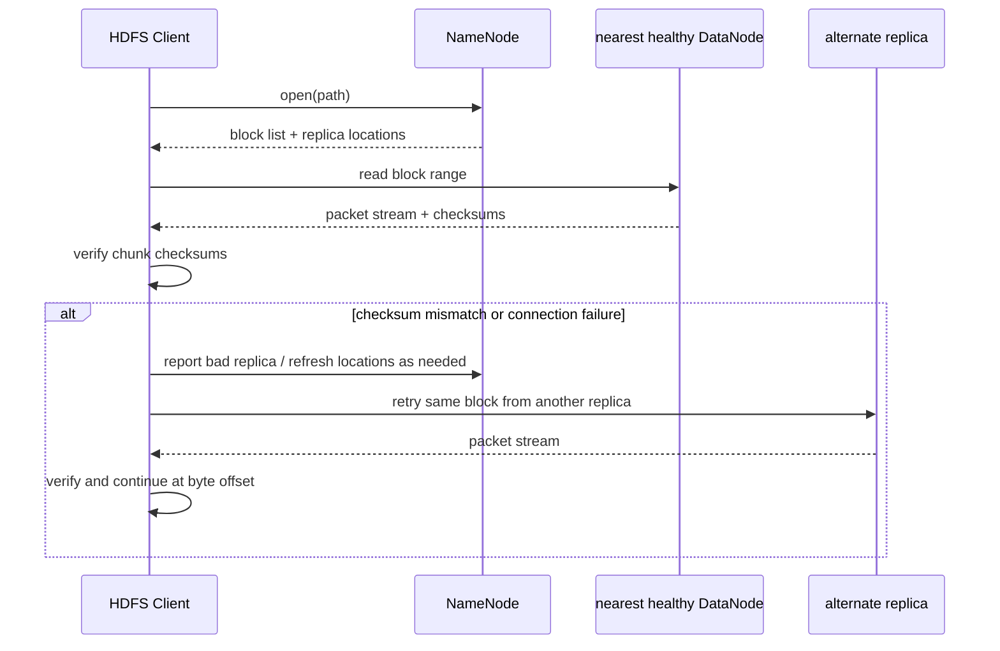

# Deep Dive: HDFS internals — от namespace до DataNode

Уровень: **Senior** · Версия для изучения: **Apache Hadoop 3.5.0** (релиз 2026-04-02; ссылки ниже закреплены за этой версией) · Предпосылки: Linux, TCP/IP, файловые системы, репликация, Java.

Цель — проследить, как HDFS принимает решение о файле и блоках, пишет и читает байты, сохраняет метаданные и восстанавливается после отказов. HDFS рассчитан на большие потоковые наборы данных. Его модель сознательно отдаёт приоритет пропускной способности, последовательному I/O и автоматическому восстановлению; она не обещает универсальную POSIX-семантику или низкую задержку произвольных мелких обновлений.

> Команды рассчитаны на Linux shell и настроенный Hadoop 3.5.0 client. Административные команды требуют прав оператора. Настройки и доступные EC policies различаются между кластерами; сначала проверь `hdfs version` и `hdfs <command> -help`.

## 1. Откуда взялся HDFS и какую цену выбрал

HDFS вырос из задачи Apache Nutch: хранить и обрабатывать большие crawl datasets на обычных серверах. Google File System (GFS) ранее сформулировал похожую модель для больших файлов, потокового чтения, недорогого оборудования и частых отказов компонентов. HDFS использует родственные идеи, но является отдельной реализацией и проектным контрактом, а не клоном GFS. [HDFS Architecture, 3.5.0](https://hadoop.apache.org/docs/r3.5.0/hadoop-project-dist/hadoop-hdfs/HdfsDesign.html) · [The Google File System, SOSP 2003](https://research.google/pubs/the-google-file-system/)

| Этап | Архитектурный ответ | Цена и последствия |
| --- | --- | --- |
| Nutch/Hadoop, batch datasets | Большие файлы разбиваются на блоки; metadata централизована, байты реплицируются на DataNode | Потоковые scan jobs на commodity hardware; NameNode становится критическим control plane |
| Ранний HDFS | Один NameNode владеет namespace | Простая модель; отказ NN останавливает доступ к namespace до восстановления |
| HDFS 2.x | HA NameNodes и Federation | HA сокращает простой; Federation делит namespace между независимыми nameservice |
| HDFS 3.x | Erasure Coding и Router-based Federation | Меньше избыточности для холодных данных и единая маршрутизация namespace ценой дополнительной сложности |

Главная граница: **NameNode координирует namespace и размещение, DataNodes передают и хранят payload**. Клиент не прокачивает весь файл через NN. [HDFS Architecture](https://hadoop.apache.org/docs/r3.5.0/hadoop-project-dist/hadoop-hdfs/HdfsDesign.html) · [HA with QJM](https://hadoop.apache.org/docs/r3.5.0/hadoop-project-dist/hadoop-hdfs/HDFSHighAvailabilityWithQJM.html) · [Federation](https://hadoop.apache.org/docs/r3.5.0/hadoop-project-dist/hadoop-hdfs/Federation.html)

## 2. Роли и состояние системы



- **NameNode (NN)**: namespace, inode/file metadata, block IDs, желаемая репликация/EC policy, block-to-DataNode map в памяти, permissions, leases, quota и расписание repair.
- **DataNode (DN)**: локальные блоки и checksum metadata, data-transfer endpoint, heartbeats/block reports, фоновые scans, replication и EC reconstruction.
- **JournalNode (JN)**: shared edit log для HA nameservice. Это не DataNode; он не хранит file blocks.
- **Standby NN**: tail-ит edits, применяет namespace изменения и следит за DN; подготовлен к takeover и выполняет checkpoint в HA.
- **Клиент**: запрашивает metadata у NN, после чего напрямую читает/пишет DNs.

## 3. Namespace, FsImage, edits и checkpoint

### 3.1 Что хранит NameNode

Путь обходится как дерево директорий/inode. Запись файла ссылается на упорядоченные HDFS blocks и хранит владельца, group, mode, replication или EC policy, timestamps, snapshots и другие namespace properties. NN держит активное namespace состояние и block-management maps в heap. DNs периодически сообщают liveness и список блоков, которые физически содержат; живая карта размещения сверяется с DN reports, а не является payload или неизменной истиной внутри FsImage.

При добавлении файла из многих блоков растут и inode metadata, и block metadata. Свободные диски сами по себе не гарантируют, что NameNode хватит heap/RPC capacity: важны число файлов, директорий и блоков, ACL, snapshots, leases и другие функции.

### 3.2 FsImage + EditLog

- **FsImage** — сохранённый checkpoint namespace.
- **EditLog** — упорядоченный журнал namespace mutations после checkpoint: create, rename, permission changes, allocation/finalize block, изменение replication factor.
- При старте NN загружает FsImage, применяет последующие edits в памяти, входит в safemode, пока DataNodes сообщают состояние, затем возобновляет block-management работу после выполнения условий выхода.
- **Checkpoint** объединяет согласованный namespace snapshot с накопленными edits и начинает новый log segment. Он ограничивает время replay при restart и рост журнала; file payload не checkpoint-ится.

`SecondaryNameNode` исторически помогал делать checkpoint у **non-HA** NameNode: загружал image/edits, объединял metadata и публиковал новый checkpoint. Это не hot standby, не HA failover и не реплика payload. В HA checkpoint делает Standby; руководство QJM прямо говорит, что отдельный SecondaryNameNode/CheckpointNode/BackupNode не нужен и его не следует ставить в такой кластер. Не интерпретируй старый термин как современный HA компонент. [HDFS metadata persistence](https://hadoop.apache.org/docs/r3.5.0/hadoop-project-dist/hadoop-hdfs/HdfsDesign.html) · [QJM guide](https://hadoop.apache.org/docs/r3.5.0/hadoop-project-dist/hadoop-hdfs/HDFSHighAvailabilityWithQJM.html)

Бэкап NameNode metadata и HA edit history проектируется отдельно от block replication. Три копии блоков не восстанавливают потерянный namespace. Проверяй восстановление metadata на отдельном кластере по поддерживаемой процедуре.

## 4. HA: QJM, JournalNodes и fencing

HA nameservice обычно состоит из Active + Standby NN, трёх или более JournalNodes и, для автоматического failover, ZooKeeper + ZKFailoverController (ZKFC) на NameNode узлах. Active durably записывает edits на **большинство** JNs. При трёх JNs достаточно двух успешных копий; конфигурация выдерживает отказ одного JN. Standby tail-ит и применяет edits. DataNodes сообщают состояние всем NameNodes, чтобы Standby знал block locations.

```text
Active commit: append edit to JN majority -> namespace RPC succeeds
Standby: tail committed edits -> update in-memory namespace -> checkpoint
Failover: Standby catches up -> takes writer epoch on JNs -> becomes Active
```

JournalNodes обеспечивают одного writer через epoch/lock журнала. Новый Active получает право писать в journal, что не даёт старому продолжать commit-ить metadata. Это защищает от split-brain write, но само по себе не убивает старый process и не гарантирует, что он сразу прекратит отвечать устаревшими reads. Настрой и проверь fencing как дополнительную защиту. ZKFC/ZooKeeper отвечают за health detection и election; это не то же самое, что fencing или quorum edits. Для ручного перехода используй координированный `hdfs haadmin -failover`; не делай `-transitionToActive` generic incident step без своей процедуры fencing.



JN quorum — metadata quorum, не quorum блоков. Потеря большинства JNs блокирует namespace mutations даже при доступных DataNodes. Живой quorum не спасает физически потерянные блоки. Разноси JNs по failure domains; следи за edit sync latency, недоступными JNs, Standby lag, checkpoint и failover. [HA with QJM: architecture, quorum and fencing](https://hadoop.apache.org/docs/r3.5.0/hadoop-project-dist/hadoop-hdfs/HDFSHighAvailabilityWithQJM.html)

## 5. DataNode blocks, checksums и data path

Файл делится на настраиваемые блоки (128 MiB — распространённый default profile; смотри конфигурацию кластера). DataNode хранит локальный block file и checksum metadata рядом с ним. HDFS считает checksums для более мелких chunks внутри блока; writer передаёт packets с data и checksums, читатель проверяет полученные bytes. При порче client сообщает corrupt replica и пробует другой источник. Checksum обнаруживает повреждение; replicas/EC дают другой экземпляр или способ реконструкции. Ни то ни другое не проверяет бизнес-смысл содержимого.



**Pipeline ACK.** Клиент разбивает поток на packets с sequence numbers. DN пишет локальные данные и передаёт packet следующему узлу; успешный ACK возвращается по цепочке от хвоста к клиенту. Клиент считает packet принятым после успеха pipeline. При отказе узла или линка клиент/DNs восстанавливают pipeline без неработающего target, если возможно; NN выделяет замену и возвращает block к желаемому уровню избыточности. Успешный `write()` в буфер приложения не означает, что файл опубликован и закрыт. `close()` ждёт оставшиеся packets и file completion. Для `hflush()`/`hsync()` проверь точный контракт используемой версии и приложения.

### Read path



NN участвует в получении block locations, но не проксирует bytes. Выбор реплики учитывает network topology и предпочитает локальную/близкую копию. Data locality — возможность для scheduler, а не обещание, что любой reader окажется рядом.

## 6. Rack-aware placement: replicas или EC

### 6.1 Rack awareness

NameNode сопоставляет DN с network location через rack-awareness configuration. Проверь результат `hdfs dfsadmin -printTopology`: если все hosts попали в default rack, на уровне rack фактической изоляции нет. Распространённое размещение с replication factor 3: replica на локальном узле/rack writer-а, вторая — на удалённом rack, третья — на другом узле этого удалённого rack. Это защищает от потери одного rack и ограничивает cross-rack write traffic; три replicas не означают три разных racks. Rack и storage-type policies ограничивают eligible targets. При нехватке DNs/racks требуемая replication не достигнется.

### 6.2 Replication

Replication factor `r=3` хранит три полные копии (raw-space factor 3x, то есть 200% сверх одной логической копии). Чтение просто выбирает одну replica, проверяет checksum и при проблеме пробует другую. Плата — место и replica traffic; плюс — простое восстановление и часто более лёгкий read path.

### 6.3 Striped erasure coding

Для схемы EC `(k,m)` HDFS разбивает logical data на `k` data cells и считает `m` parity cells на stripe. `RS-6-3-1024k` даёт nominal space factor `(6+3)/6 = 1.5x`; может восстановить до трёх потерянных internal blocks, если достаточно других частей stripe и placement покрывает failure domains. Чтение/repair могут затребовать cells из нескольких DNs и decode, расходуя CPU, сеть и диск. Клиент пишет параллельными streamers в block group. EC policy задаётся на directory для новых файлов внутри; replication factor не превращает EC-файл в replicated и `-setrep` не является способом миграции.

Replicas подходят горячим данным, небольшим random reads и простому write/recovery path. EC стоит рассмотреть для крупных более холодных наборов, когда экономия места оправдывает CPU/network cost, а у кластера достаточная ширина и резерв для реконструкции. Сравнивай на реальных размерах и частоте доступа. Документация 3.5.0 перечисляет policies `RS-3-2-1024k`, `RS-6-3-1024k`, `RS-10-4-1024k`, `XOR-2-1-1024k`; какие включены и допустимы — зависит от кластера. [HDFS Erasure Coding, 3.5.0](https://hadoop.apache.org/docs/r3.5.0/hadoop-project-dist/hadoop-hdfs/HDFSErasureCoding.html)

## 7. Federation и block pools

Один nameservice имеет namespace, которым управляет один NN (либо HA-пара). **Federation** добавляет независимые namespaces/nameservices. DataNodes могут регистрироваться у нескольких NNs и хранить blocks нескольких namespace. У каждого namespace свой **block pool** — набор принадлежащих ему blocks, который управляет его NN. Federation расширяет metadata capacity и изолирует tenants/workloads, но сама по себе не делит одно дерево каталогов между NNs.

`ViewFs` может показать клиенту несколько nameservices через mount table. Router-based Federation добавляет Router + State Store/shared mount table, чтобы маршрутизировать namespace RPC к правильному subcluster; client всё равно подключается к DNs для bytes. Добавляются routing, quotas, health, конфигурация и cross-namespace migration. Планируй partition заранее. [HDFS Federation, 3.5.0](https://hadoop.apache.org/docs/r3.5.0/hadoop-project-dist/hadoop-hdfs/Federation.html) · [Router-based Federation, 3.5.0](https://hadoop.apache.org/docs/r3.5.0/hadoop-project-dist/hadoop-hdfs-rbf/HDFSRouterFederation.html)

## 8. Почему мелкие файлы вредят

Файл 10 KB всё равно создаёт namespace entry и block-management state. Миллионы файлов дают много inode, directory entries, block records, permissions и metadata RPC при небольшом объёме payload. Симптомы: NameNode heap/GC pressure и медленные namespace операции, долгие listings, медленные checkpoint/restart, scheduler overhead из множества tiny input splits. Это проблема cardinality, не только дискового объёма.

- Пакуй записи в разумного размера Parquet/ORC/Avro/SequenceFiles; компакти мелкие data files до наращивания параллелизма.
- HAR подходит для некоторых неизменяемых исторических наборов, если ограничения доступа приемлемы.
- Для большого числа крошечных blobs без необходимости в HDFS path semantics оцени object store или packed-blob систему.
- Federation применяй, если нужна горизонтальная namespace capacity/throughput и у каждого subtree есть владелец. Она добавляет namespaces, а не отменяет стоимость inode.
- Большой block size сокращает число blocks у больших файлов, но не устраняет один inode на каждый файл.

Совместно измеряй file/block count, распределение размеров файлов, heap NameNode после full GC, checkpoint duration, RPC latency и listing latency. Дисковое место может быть свободно, а cluster всё равно упрётся в metadata.

## 9. Отказы, восстановление и повседневные операции

### Startup и отказы

При старте NN replay-ит metadata и входит в **safemode**. Он собирает heartbeats и block reports; replication/deletion work приостановлена, пока не выполнены условия выхода из safe mode. Потеря heartbeat помечает DN недоступным по настроенному timeout. Блоки, у которых реплик меньше желаемого, попадают в очередь repair. Читатель, обнаруживший плохой checksum, может сменить replica и сообщить о повреждённой. Не используй `forceExit` из safemode как общий способ «починить» cluster: сначала выясни, что именно вызвало состояние.

### Rebalance, decommission и maintenance

- **Cluster Balancer** переносит replicas между DataNodes, приближая utilization к политике и порогу. Это операторский процесс, а не обещание мгновенного перемещения данных после добавления DN. Он использует сеть/диски; задай bandwidth budget, наблюдай application p99 и сохрани reserve для восстановления.
- **DiskBalancer** переносит блоки между volume внутри одного DataNode. Это другой вид skew.
- **Decommission** помечает DN для вывода; NN сначала планирует достаточные replicas на других узлах и только затем переводит DN в `DECOMMISSIONED`. Проверь состояние через `dfsadmin -report` и scoped `fsck`, прежде чем останавливать узел.
- **Maintenance state** нужен для временной запланированной недоступности; он имеет отличающуюся от decommission policy. Следуй DataNode Admin guide для версии кластера.
- **EC reconstruction** читает сохранившиеся stripe parts, декодирует недостающие internal blocks и записывает замены. Это дороже копирования полной replica и конкурирует с foreground jobs за сеть/диски.

### Что контролирует senior operator

1. NN heap/full-GC pauses, RPC queue/latency, inode и block counts, edits/checkpoint age и duration, safemode, open leases, HA role.
2. JN quorum, edit sync p95/p99, Standby lag, ZKFC state, fencing outcomes, failover и client retry/error rates.
3. DN disk fullness/failed volumes, heartbeat/report freshness, slow nodes, under-replicated/missing/corrupt blocks, EC reconstruction backlog и rack placement.
4. Capacity headroom **по failure domain**, не только средний percent; balancer/repair bandwidth, network drops и cross-rack traffic.
5. Восстановление metadata backup, Kerberos/keytab rotation, permissions/ACLs, encryption zones/KMS, quotas и upgrade rollback.

Snapshots помогают при некоторых ошибках namespace, но не являются off-cluster backup. Replication защищает от отдельных аппаратных отказов, но не от случайного удаления, скомпрометированных credentials или потери площадки. Планируй RPO/RTO и drill для metadata и payload отдельно. [DataNode Admin Guide, 3.5.0](https://hadoop.apache.org/docs/r3.5.0/hadoop-project-dist/hadoop-hdfs/HdfsDataNodeAdminGuide.html) · [HDFS Commands, 3.5.0](https://hadoop.apache.org/docs/r3.5.0/hadoop-project-dist/hadoop-hdfs/HDFSCommands.html)

## 10. Security model

Default Hadoop **simple** mode криптографически не аутентифицирует удалённого пользователя. Ограничивай сетевой доступ; поля owner/group не доказывают, кто аутентифицировался. Secure mode использует Kerberos для клиентов и сервисов, principals/keytabs, mapping principal-to-local-user, group mapping, authorization, permissions/ACLs и delegation tokens для долгих jobs. Keytabs и service identities — production secrets.

RPC authentication и конфиденциальность данных — отдельные настройки. В зависимости от требований настрой RPC protection и DataNode transfer protection для integrity/privacy; используй TLS/HTTPS для Web endpoints. Block access tokens авторизуют data-transfer операции. HDFS encryption zones дают прозрачное client-side шифрование содержимого с ключами в Hadoop KMS; они не шифруют namespace metadata и не отменяют проектирование доступности/прав KMS. [Hadoop Secure Mode, 3.5.0](https://hadoop.apache.org/docs/r3.5.0/hadoop-project-dist/hadoop-common/SecureMode.html) · [HDFS Transparent Encryption, 3.5.0](https://hadoop.apache.org/docs/r3.5.0/hadoop-project-dist/hadoop-hdfs/TransparentEncryption.html) · [HDFS Permissions](https://hadoop.apache.org/docs/r3.5.0/hadoop-project-dist/hadoop-hdfs/HdfsPermissionsGuide.html)

## 11. Подходящие и неподходящие нагрузки

**Хороший fit:** большие неизменяемые или append-oriented datasets; повторные последовательные scans; Hadoop/Spark jobs, которые планируются рядом с blocks; on-prem кластеры с предсказуемой capacity и Hadoop-командой; задачи, которым полезны hierarchical paths и hints о data locality.

**Плохой fit:** миллионы latency-sensitive операций с tiny files; частые random overwrite/in-place mutation; базы данных, ожидающие поведение local disk fsync/locking; резко эластичный compute, не желающий владеть storage lifecycle; множество независимых клиентов в регионах; приложения, которым важнее S3 object/version/lifecycle semantics.

`append`, snapshots и другие возможности не превращают HDFS в низколатентную изменяемую filesystem. Выбирай по семантике и общей стоимости, а не только потому что движок понимает `hdfs://`.

## 12. Сравнение с соседними системами

| Система | Основная модель | Возможное преимущество относительно HDFS | Отличающий trade-off |
| --- | --- | --- | --- |
| **HDFS** | Namespace на NameNode, blocks на DataNodes, replication/EC | Hadoop data locality и batch scans | Namespace масштабируют Federation; metadata plane нужно sizing/HA-операциям |
| **Ceph** | RADOS + CRUSH; RBD block, CephFS file, RGW object | Self-managed substrate с block/file/object API, динамический placement | Более широкая поверхность: MON/OSD/MDS/RGW, maps/PGs и recovery; другой request/failure model |
| **Apache Ozone** | Object store, Ozone Manager для namespace, SCM для block space | Hadoop ecosystem, очень большое число объектов, S3-compatible/object-first интерфейс | Не равен HDFS по семантике; сверяй S3, OFS/`o3fs` и версию |
| **Lustre** | Параллельная POSIX FS: MDS/MDT metadata, OSS/OST data striping | HPC, shared POSIX paths и высокопараллельный file I/O | Раздельные metadata/data tiers и HPC клиентская инфраструктура; не HDFS block/object contract |
| **Amazon S3** | Управляемый object API: bucket/key | Отделить compute lifecycle от storage, облачный доступ и object lake | Object semantics, multipart и request/network costs отличаются от POSIX; S3A — адаптер, не HDFS |
| **SeaweedFS** | Master отслеживает volume placement/IDs, volume servers — blobs, Filer — namespace в metadata backend; есть S3 API | Self-hosted blob/file API с большим числом small blobs и независимо масштабируемыми слоями | Filer DB, repair/vacuum/EC и совместимость API — отдельные эксплуатационные поверхности |

Таблица сопоставляет модели, а не benchmark или универсальную durability гарантию. Сверь request semantics, HA topology, security, replica/EC policy, file/object count и repair behavior по версиям систем. [Ceph Architecture](https://docs.ceph.com/en/latest/architecture/) · [Apache Ozone Architecture 2.2.1](https://ozone.apache.org/docs/core-concepts/architecture/overview/) · [Lustre Architecture for Admins](https://wiki.lustre.org/Lustre_Architecture_for_Admins) · [Amazon S3 User Guide](https://docs.aws.amazon.com/AmazonS3/latest/userguide/Welcome.html) · [Hadoop S3A, 3.5.0](https://hadoop.apache.org/docs/r3.5.0/hadoop-aws/tools/hadoop-aws/index.html) · [SeaweedFS architecture](https://github.com/seaweedfs/seaweedfs#architecture)

## 13. HDFS CLI: путь от файла к размещённым блокам

Нужен Hadoop 3.5.0 client, `HADOOP_CONF_DIR` с `core-site.xml` и `hdfs-site.xml`, и `fs.defaultFS` с действующим NameNode URI или HA nameservice URI. На secured cluster сначала получи Kerberos ticket командой `kinit`. Примеры создают путь только в `/training/hdfs-internals` текущего HDFS namespace.

```bash
hdfs version
hdfs dfs -mkdir -p /training/hdfs-internals
printf 'HDFS pipeline probe\n' > /tmp/hdfs-probe.txt
hdfs dfs -put -f /tmp/hdfs-probe.txt /training/hdfs-internals/probe.txt
hdfs dfs -ls -h /training/hdfs-internals
hdfs dfs -cat /training/hdfs-internals/probe.txt
hdfs dfs -checksum /training/hdfs-internals/probe.txt
hdfs dfs -setrep -w 2 /training/hdfs-internals/probe.txt
hdfs fsck /training/hdfs-internals -files -blocks -locations
hdfs fsck /training/hdfs-internals -files -blocks -racks
hdfs dfsadmin -report -live
hdfs dfsadmin -printTopology
```

`fsck` здесь только читает состояние. `-setrep -w 2` реально меняет replication factor одного файла: запускай только в разрешённом тестовом namespace. HA состояние, если настроено:

```bash
hdfs haadmin -getAllServiceState
```

Для EC сначала проверь доступные и поддерживаемые policies. `RS-6-3-1024k` можно назначать лишь если она включена, подходит topology и есть достаточно DataNodes. Directory policy применяется к новым файлам внутри:

```bash
hdfs ec -listPolicies
hdfs ec -verifyClusterSetup -policy RS-6-3-1024k
hdfs dfs -mkdir -p /training/hdfs-internals/ec
hdfs ec -setPolicy -policy RS-6-3-1024k -path /training/hdfs-internals/ec
hdfs ec -getPolicy -path /training/hdfs-internals/ec
```

Если setup check не прошёл, не применяй эту policy; выбери проверенную политику или пропусти EC шаг. Не выполняй `-enablePolicy`, Balancer, decommission или failover без согласованного окна и оценки нагрузки.

## 14. Java API: запись и проверочное чтение

Пример использует classpath Hadoop 3.5.0 и конфигурацию из `HADOOP_CONF_DIR`. Для HA URI передай, например, `hdfs://analytics` с соответствующими mappings в `hdfs-site.xml`; для non-HA — `hdfs://nn1.example.net:8020`. Код создаёт новый файл (`overwrite=false`), закрывает stream, открывает его заново и сравнивает bytes. Повторный запуск с тем же path сообщит, что файл уже существует.

```java
import java.io.ByteArrayOutputStream;
import java.net.URI;
import java.nio.charset.StandardCharsets;
import java.util.Arrays;

import org.apache.hadoop.conf.Configuration;
import org.apache.hadoop.fs.FSDataInputStream;
import org.apache.hadoop.fs.FSDataOutputStream;
import org.apache.hadoop.fs.FileSystem;
import org.apache.hadoop.fs.Path;

public final class HdfsProbe {
  public static void main(String[] args) throws Exception {
    if (args.length != 2) {
      throw new IllegalArgumentException(
          "Usage: HdfsProbe <hdfs-uri> <absolute-hdfs-path>");
    }

    URI hdfsUri = URI.create(args[0]);
    Path path = new Path(args[1]);
    byte[] expected = "HDFS packet pipeline\n".getBytes(StandardCharsets.UTF_8);
    Configuration conf = new Configuration();

    try (FileSystem fs = FileSystem.newInstance(hdfsUri, conf)) {
      Path parent = path.getParent();
      if (parent != null && !fs.mkdirs(parent) && !fs.getFileStatus(parent).isDirectory()) {
        throw new IllegalStateException("Could not create parent directory: " + parent);
      }

      try (FSDataOutputStream out = fs.create(
          path,
          false,                 // fail if target exists
          64 * 1024,             // client buffer
          (short) 3,             // desired replicas; an EC dir policy takes precedence
          128L * 1024 * 1024)) { // requested block size, not guaranteed placement
        out.write(expected);
      } // close drains the pipeline and finalizes the file with NameNode

      ByteArrayOutputStream actual = new ByteArrayOutputStream();
      byte[] buffer = new byte[8192];
      try (FSDataInputStream in = fs.open(path)) {
        int count;
        while ((count = in.read(buffer)) != -1) {
          actual.write(buffer, 0, count);
        }
      }

      if (!Arrays.equals(expected, actual.toByteArray())) {
        throw new IllegalStateException("Read-back bytes differ from the written payload");
      }
      System.out.println("Verified " + actual.size() + " bytes at " + path);
    }
  }
}
```

Linux compile/run с Hadoop distribution в `PATH`:

```bash
javac -cp "$(hadoop classpath)" HdfsProbe.java
java -cp ".:$(hadoop classpath)" HdfsProbe hdfs://analytics /training/hdfs-internals/from-java.txt
```

Replication, block size, defaults и EC поведение зависят от кластерной конфигурации и directory policy. На secure cluster нужны Kerberos credentials и права пользователя. [Hadoop FileSystem API, 3.5.0](https://hadoop.apache.org/docs/r3.5.0/api/org/apache/hadoop/fs/FileSystem.html) · [FileSystem Shell Guide, 3.5.0](https://hadoop.apache.org/docs/r3.5.0/hadoop-project-dist/hadoop-common/FileSystemShell.html)

## 15. Senior lab: follow a block, cause a failure, explain the repair

**Время:** 60–90 минут. **Среда:** disposable HDFS 3.5.0 cluster, минимум 3 DataNodes; для rack проверки — DataNodes минимум в двух реальных racks; для `RS-6-3` — минимум 9 подходящих DataNodes. Fault injection только на тестовом кластере.

1. **Зафиксируй состояние:** `hdfs version`, `hdfs dfsadmin -report -live`, `hdfs dfsadmin -printTopology`, `hdfs haadmin -getAllServiceState` (последняя команда только для HA). Подтверди DN count/racks, safemode и spare capacity.
2. **Проследи блоки:** создай fixture размером 260 MiB: `dd if=/dev/zero of=/tmp/hdfs-large.bin bs=1M count=260 status=none`. Загрузи как `/training/hdfs-internals/large.bin`; выполни `hdfs fsck /training/hdfs-internals/large.bin -files -blocks -locations` и отдельно `hdfs fsck /training/hdfs-internals/large.bin -files -blocks -racks`. Объясни block count, replica count и rack размещение.
3. **Проверь API и bytes:** запусти Java пример на отдельном path. Сравни `hdfs dfs -checksum` с `md5sum`/`sha256sum` локального файла; объясни, почему HDFS file checksum не обязан быть равен MD5 файла.
4. **Проверь durability policy:** измени `large.bin` на 2 replica через `hdfs dfs -setrep -w 2 ...`, повтори `fsck`. Если стенд предусматривает возврат исходного уровня, восстанови его. Если доступна EC policy, создай отдельную EC directory, запиши туда новый файл и сравни логический block group с внутренними блоками.
5. **Recovery в тестовой среде:** с согласованным окном останови DataNode, содержащий тестовые replicas. Наблюдай dead DN/under-replicated blocks; верни DN и дождись repair. Запиши block locations, нагрузку сети и время деградации. Не останавливай узел, если не можешь однозначно подтвердить, что cluster disposable.
6. **Decommission drill:** в изолированном кластере добавь один DN в exclude file, обнови NameNode через `hdfs dfsadmin -refreshNodes`, дождись перехода `DECOMMISSION_INPROGRESS` в `DECOMMISSIONED`; проверь `fsck` перед остановкой DN.
7. **HA tabletop:** нарисуй последовательность при потере Active, отказе одного из трёх JNs и отказе двух JNs. Обозначь, какие namespace операции блокируются, что делает Standby и зачем нужны fencing + client failover.
8. **Записка senior engineer:** предложи SLO для p99 read, metadata RPC, времени восстановления, heap utilization, RPO/RTO metadata и reserve capacity; укажи dashboard/alerts и команды on-call проверки.

**Ожидаемый результат:** схема control/data path, вывод `fsck` с объяснением блоков и racks, byte/checksum проверка, таблица одного отказа/repair, объяснение NameNode pressure от small files и обоснование выбора replicated либо EC под конкретную нагрузку. Оценивается понимание failure domains и операций, а не длина логов.

## Источники Apache Hadoop 3.5.0

- [Релиз Apache Hadoop 3.5.0](https://hadoop.apache.org/release/3.5.0.html)
- [HDFS Architecture](https://hadoop.apache.org/docs/r3.5.0/hadoop-project-dist/hadoop-hdfs/HdfsDesign.html)
- [HDFS HA с Quorum Journal Manager](https://hadoop.apache.org/docs/r3.5.0/hadoop-project-dist/hadoop-hdfs/HDFSHighAvailabilityWithQJM.html)
- [HDFS Erasure Coding](https://hadoop.apache.org/docs/r3.5.0/hadoop-project-dist/hadoop-hdfs/HDFSErasureCoding.html)
- [HDFS Federation](https://hadoop.apache.org/docs/r3.5.0/hadoop-project-dist/hadoop-hdfs/Federation.html) · [Router-based Federation](https://hadoop.apache.org/docs/r3.5.0/hadoop-project-dist/hadoop-hdfs-rbf/HDFSRouterFederation.html)
- [HDFS Commands](https://hadoop.apache.org/docs/r3.5.0/hadoop-project-dist/hadoop-hdfs/HDFSCommands.html) · [DataNode Admin](https://hadoop.apache.org/docs/r3.5.0/hadoop-project-dist/hadoop-hdfs/HdfsDataNodeAdminGuide.html) · [Rack Awareness](https://hadoop.apache.org/docs/r3.5.0/hadoop-project-dist/hadoop-common/RackAwareness.html)
- [Hadoop Secure Mode](https://hadoop.apache.org/docs/r3.5.0/hadoop-project-dist/hadoop-common/SecureMode.html) · [HDFS Transparent Encryption](https://hadoop.apache.org/docs/r3.5.0/hadoop-project-dist/hadoop-hdfs/TransparentEncryption.html) · [HDFS Permissions](https://hadoop.apache.org/docs/r3.5.0/hadoop-project-dist/hadoop-hdfs/HdfsPermissionsGuide.html)
- [Hadoop FileSystem API](https://hadoop.apache.org/docs/r3.5.0/api/org/apache/hadoop/fs/FileSystem.html) · [FileSystem Shell](https://hadoop.apache.org/docs/r3.5.0/hadoop-project-dist/hadoop-common/FileSystemShell.html)
