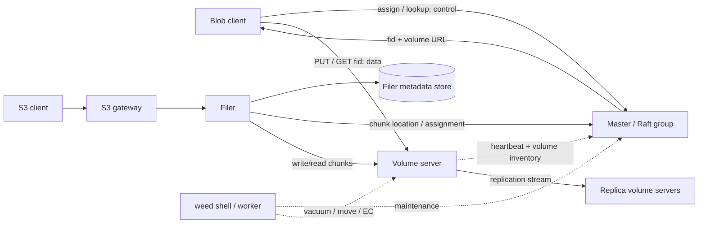
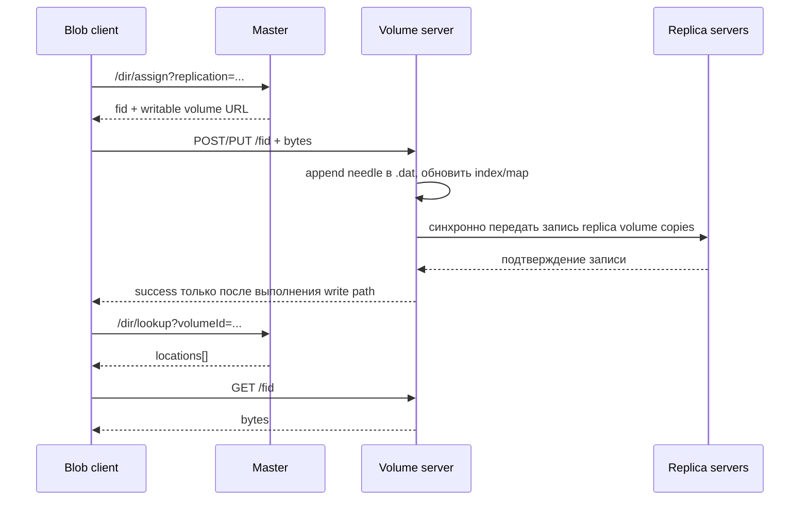

# SeaweedFS изнутри: от blob store до эксплуатации

Senior-level deep dive для Lesson 04b. SeaweedFS удобно понимать как два слоя с разными контрактами: нижний blob store адресует содержимое по `file ID` и раскладывает его по томам; Filer добавляет namespace, а S3 gateway переводит bucket/key API в операции Filer. Master ведёт карту томов и назначает ID, но сами байты он не проксирует.

> Числа, формат команды и доступность S3-операций меняются между версиями. При проектировании сверяйте команды и гарантии с README/Wiki/API для закреплённого релиза. Ссылки ниже ведут на первичные материалы upstream `seaweedfs/seaweedfs`.

## 1. Мотивация: Haystack, маленькие файлы и S3

У традиционной POSIX-файловой системы есть цена за каждый файл: inode и метаданные, directory lookup, отдельное создание/удаление файловых объектов и фрагментация. Это хорошо для файлового namespace и произвольных операций с файлами, но плохо масштабируется для десятков миллиардов маленьких неизменяемых объектов. Facebook описал эту проблему для photo store в работе [Finding a Needle in Haystack](https://www.usenix.org/legacy/event/osdi10/tech/full_papers/Beaver.pdf): объединить маленькие blobs в крупные append-oriented файлы, держать компактный индекс отдельно и читать blob одним seek.

SeaweedFS использует похожую идею, но это не буквальный порт Haystack. Volume — контейнер множества needles; его индекс позволяет найти диапазон в `.dat`. Master хранит соответствие **volume → volume server**, а не строку метаданных на каждый blob. Поэтому число объектов может быть намного больше числа записей, которые должен отслеживать master. При этом у volume server остаются индекс и операции локального диска, а у Filer — отдельная задача хранения path/key namespace.

S3 добавляет удобный прикладной контракт: объект — это bucket + key и набор HTTP-операций, а не открытый блочный девайс. SeaweedFS может предложить такой API поверх своего blob store. Совпадение API облегчает интеграцию, но само по себе не означает совпадение всех семантик и эксплуатационных гарантий с Amazon S3.

## 2. Компоненты и control plane / data plane

| Компонент | Что хранит или делает | На горячем пути |
| --- | --- | --- |
| Master | Выдаёт file ID, выбирает подходящий writable volume, ведёт топологию и расположение volume copies | Нужен для назначения и lookup, не переносит blob bytes |
| Volume server | Локальные `.dat`/`.idx`, needle map в памяти или выбранном index backend; репликация и чтение needle | Хранит и обслуживает blob bytes |
| Filer | Hierarchical namespace, file attributes, список chunks и путь к ним; подключён к metadata store | Участвует в path/file операциях, включая S3 gateway path |
| Filer metadata store | Ключи namespace и сериализованные записи Filer; например PostgreSQL, MySQL, Redis, Cassandra либо подходящий встроенный store | Критичен для имён, каталогов и chunk references |
| S3 gateway | Переводит bucket/key, IAM и S3 операции в интерфейс Filer | На каждом S3 запросе |
| Admin / worker | Maintenance: vacuum, balance, replica repair, EC и другие задачи | Не часть обычного чтения объекта |



У прямого blob API и S3 API разные data paths. В первом случае клиент получает `fid` и volume URL, затем обращается к volume server сам. Во втором запрос проходит через S3 gateway и Filer; мастер всё равно не становится byte proxy, но внешний S3-клиент не перепрыгивает через gateway.

## 3. Master, Raft, топология и назначение volume

### Master видит volumes, а не каждый объект

Volume servers объявляют master-у доступные volumes и их параметры через heartbeat. Master использует эту карту, чтобы выбрать writable volume, который соответствует запросу: collection, replication placement, TTL, data center/rack, disk type, ожидаемый размер и доступная ёмкость. Выдача file key — control-plane операция. Объём состояния master-а определяется количеством volume copies и топологией, а не количеством пользовательских файлов.

В production master обычно запускают группой из трёх участников с Raft consensus: кластер переживает отказ одного участника, пока доступны большинство и сеть между ними. Raft обеспечивает согласованность master group и выбор лидера. Он не реплицирует `.dat` и не заменяет volume replication. Потеря quorum мешает control-plane операциям; наличие копий данных на volume servers не возвращает master quorum.

Каталог master-а (`-mdir`) содержит устойчивое состояние и Raft данные. Его нельзя считать временным контейнерным каталогом: потеря каталога, peer identity или адресной схемы может превратить рестарт в запуск другого кластера. В Kubernetes chart upstream отдельно предупреждает, что ephemeral `hostPath` не следует за rescheduled pod. Сохраняйте master data на устойчивом хранилище и проверяйте восстановление Raft group.

### Topology и replication code

Topology строится уровнями data center → rack → volume server → disk type. Репликация задаётся трёхзначным кодом `xyz`: дополнительные копии в других data centers, других racks того же DC и других volume servers той же rack. Например:

| Код | Целевое размещение дополнительных копий | Практический смысл |
| --- | --- | --- |
| `000` | Нет | Один экземпляр; тест или данные, восстанавливаемые из другого источника |
| `001` | Одна копия на другом сервере той же rack | Переживает отказ процесса/диска только если копия на другом узле; не переживает потерю rack |
| `010` | Одна копия на другой rack того же DC | Разводит copies по rack при корректно заданной topology |
| `100` | Одна копия в другом DC | Межсайтовое размещение; write latency зависит от расстояния |
| `110` | По одной дополнительной копии в другом DC и rack | Две дополнительные копии с разными failure domains |

Это **дополнительные** копии к исходной. Код выражает требование placement, а не quorum. Если для требуемого размещения нет доступных серверов/томов, assignment может не состояться. Успешная запись на реплицируемый volume обычно ждёт все требуемые replica writes; это может ухудшить доступность записи при отказе одного target. Replica count нельзя выбирать отдельно от числа узлов, числа racks/DC и ожидаемого write availability.

Новый volume можно назначить на подходящих узлах без немедленного перемещения всех уже записанных байтов. Балансировка, repair и перемещение выполняются отдельными maintenance операциями. Добавление server поэтому не эквивалентно автоматическому переписыванию всего кластера.

## 4. File ID: volume, key, cookie

Пример из API: `3,01637037d6`.

| Часть | Значение в примере | Назначение |
| --- | --- | --- |
| Volume ID | `3` | Выбирает один логический volume и тем самым сокращает lookup до карты расположения этого volume |
| File key | `01` | Идентификатор needle внутри volume, в FID записан hex; внутренний тип — 64-bit ключ |
| Cookie | `637037d6` | 32-bit дополнительный компонент идентификатора, защищает от угадывания/случайного совпадения старого URL |

Cookie — не замена IAM, авторизации или подписи запроса. Не публикуйте FID, если приложение считает его секретом; включайте security/TLS и проверку доступа. FID не содержит offset в `.dat`: offset находится в локальном индексе volume server. Поэтому перенос volume должен обновить location map, а не переписывать пользовательские ссылки на каждый needle.

### Прямой blob write и read



Lookup locations кэшируем: volume обычно не переезжает при каждом запросе. При нескольких replica locations клиент выбирает доступную и может повторить GET на другой replica. FID и собственную запись `key → fid` blob-клиент должен хранить сам.

Для Filer/S3 lookup скрыт за path metadata. S3 gateway не выдаёт конечному приложению FID; он разрешает bucket/key через Filer и работает с chunks.

## 5. Volume server: append-only `.dat`, `.idx`, needle и vacuum

### На диске и в памяти

Volume — набор файлов со служебным superblock. Основные файлы:

- `.dat` — последовательность needle records с payload и служебными полями. Записи добавляются в конец; даже overwrite не требует перезаписать payload на месте.
- `.idx` — последовательный индекс записей `file key → offset, size` (типичная запись занимает 16 bytes). При старте volume server загружает index в needle map, чтобы найти offset по key без сканирования всего `.dat`.
- `.vif` и дополнительные sidecar-файлы — служебное состояние volume, версия/информация о compact и remote-tier свойства; точный набор зависит от версии и режима.

Needle хранит payload и атрибуты вроде cookie, времени, имени/MIME и checksum. Чтение сверяет идентификатор и данные, затем делает seek к известному offset. Высокая плотность маленьких файлов достигается потому, что для каждого пользовательского объекта не создаётся отдельный файл в ОС. Но «16 bytes на needle» — размер raw index entry, а не полная цена объекта в RAM: map overhead, side metadata, Filer DB, allocator и cache тоже занимают память.

Overwrite append-ит новую версию записи и продвигает индекс на новый offset; delete записывает tombstone/mark в index и при обычной локальной записи сохраняет журналирующее состояние в append-only data. Старые байты становятся garbage, но физически остаются до compaction. Это упрощает последовательную запись и восстановление состояния из index; за это платим временным write amplification и пространством на удалённые/перезаписанные объекты.

### Vacuum / compaction

`volume.vacuum` выбирает volumes, у которых доля garbage выше порога, переводит volume в режим безопасной обработки, копирует live needles в компактные файлы и подменяет старые `.dat`/`.idx`. Пик свободного места во время vacuum может быть ниже ожидаемого: старый и новый файлы какое-то время сосуществуют. Планируйте временную ёмкость и I/O budget; не запускайте массовую компактацию без оценки headroom и влияния на latency. Vacuum не равен replica repair, а repair не равен проверке backup.

Есть авто-vacuum threshold и ручной shell/API запуск. В актуальном API `garbageThreshold` описан как доля удалённых bytes; default master flag upstream — `0.3`. Конкретная нагрузка/версия может менять детали. Не используйте значение `0` как «безопасно почистить всё» без проверки объёма работ.

## 6. Replication: pipeline и семантика

Репликация выполняется на уровне volume. Master назначает file ID, чей volume соответствует replication policy; клиент направляет write на один replica volume server, затем данные проходят по цепочке/маршруту реплик. Для описанного upstream write path запись успешна, когда целевые replica writes завершились. Это strong consistency **для конкретного volume write**, а не транзакция над несколькими object keys.

Практические последствия:

1. Один недоступный обязательный target может привести к ошибке записи даже при наличии одной читаемой копии. Для повторной попытки клиенту нужен понятный idempotency/retry strategy; сетевой timeout после commit оставляет результат неопределённым для клиента.
2. Read path может выбрать одну replica и перейти к другой при ошибке. Это не устраняет последствий split network или повреждённого payload; нужны checksum/monitoring и проверяемые repair процессы.
3. Код `001` не значит «три копии» и не значит quorum 2 из 3. Это одна дополнительная копия на другом volume server той же rack; исходный экземпляр плюс копия = две записи.
4. Filer metadata store имеет собственный consistency/HA contract. Подтверждение needle replication и атомарность изменения path/chunk mapping — отдельные вещи.
5. Настройка `fsync` в HTTP API может потребовать flush на volume server; default API value указан как `false`. Долговечность ответа также зависит от OS cache, накопителя, контроллера и того, что именно подтверждает replica. Зафиксируйте desired RPO и проверяйте это отказами питания/узла на поддерживаемом окружении.

Межкластерная filer replication — отдельный асинхронный процесс, а не continuation синхронной volume write. Она помогает строить active-active/active-passive и backup flows, но добавляет lag и конфликтные сценарии.

## 7. Filer namespace, metadata store и большие файлы

Filer хранит namespace отдельно от blob payload. Path entry содержит имя, attributes, directory data и ссылки на одну или больше chunk records. Metadata store можно выбрать под профиль нагрузки: встроенный store удобен для одиночного узла, внешний HA database — когда надо обслуживать несколько filers и получать отдельный failure/recovery domain. Несколько Filer процессов не создают HA, если они используют изолированные локальные базы.

Одна запись Filer обычно ссылается на один или несколько needles. Для крупного файла Filer режет поток на chunks; метаданные описывают byte ranges и FID этих chunks. Если manifest становится большим, список ссылок может храниться через meta-chunk. Range GET тогда выбирает только пересекающиеся chunks. Это даёт bounded blob size и параллельное размещение, но увеличивает количество metadata операций и мест, которые надо согласованно резервировать и восстанавливать.

При записи крупного объекта есть несколько состояний: часть chunks уже записана; metadata mapping ещё не опубликован; часть chunks повторно записана при retry; старые chunks ещё не очищены после overwrite/delete. Поэтому senior review должен рассматривать timeout, retry, orphan cleanup и согласованное восстановление DB + bytes. Нельзя резервировать только Filer DB либо только `.dat` файлы и ожидать целостного file namespace.

Filer даёт файловый интерфейс с directory operations, `HEAD`, `Range`, conditional headers и append/copy/move вариантами API. Это не доказывает полную POSIX-семантику для lock, rename durability, ACL, fsync, mmap или произвольных random writes. Проверяйте поведение конкретного клиента и Filer store.

## 8. S3 gateway и Python пример

S3 gateway переводит bucket/key в Filer namespace и может запускаться отдельно от Master, volume и Filer. Его можно масштабировать по throughput; он обращается к одному или нескольким Filer endpoints. Bucket в типичном SeaweedFS layout соответствует отдельной collection и пути Filer. Определённые S3 функции зависят от версии и конфигурации: versioning, multipart, lifecycle, IAM/STS, Object Lock, tagging, checksums, conditional operations. Сверяйте с [списком поддерживаемых S3 API upstream](https://github.com/seaweedfs/seaweedfs/wiki/Amazon-S3-API) и делайте conformance tests теми SDK и движками, которыми пользуется приложение.

### Demo: текущий Compose lab

В [Compose стенде](../../../../labs/flink-iceberg/compose.yaml) один service `seaweedfs` запускает `server -s3` и публикует наружу только loopback endpoints `localhost:19000` (S3), `localhost:19333` (master), `localhost:18888` (Filer). Образ закреплён как `chrislusf/seaweedfs:4.46`, data directory хранится в одном Docker named volume `seaweedfs-data`; `master.volumeSizeLimitMB=128` выбран для лаборатории. Отдельных master peers, volume nodes, filers, HA metadata DB или rack/DC failure domains в Compose нет. Это реальный S3 request path, но **не HA кластер** и не proof-of-failure test.

Из корня клона `de-mentor`, PowerShell. Учётные данные являются demo значениями стенда и работают только для лабораторного окружения:

```powershell
docker compose -f labs/flink-iceberg/compose.yaml up -d seaweedfs seaweedfs-init
docker compose -f labs/flink-iceberg/compose.yaml ps seaweedfs
Invoke-RestMethod http://localhost:19333/cluster/status

$env:AWS_ACCESS_KEY_ID = 'demouser'
$env:AWS_SECRET_ACCESS_KEY = 'demosecret123456'
$env:AWS_DEFAULT_REGION = 'us-east-1'
$env:AWS_EC2_METADATA_DISABLED = 'true'
$S3 = 'http://localhost:19000'

aws --endpoint-url $S3 s3api list-buckets
aws --endpoint-url $S3 s3api put-object `
  --bucket de-mentor-warehouse --key deep-dive/demo.txt `
  --body .\lessons\lesson-04b-distributed-storage\README.md
aws --endpoint-url $S3 s3api head-object `
  --bucket de-mentor-warehouse --key deep-dive/demo.txt
aws --endpoint-url $S3 s3api get-object `
  --bucket de-mentor-warehouse --key deep-dive/demo.txt .\demo-download.txt
aws --endpoint-url $S3 s3api list-objects-v2 `
  --bucket de-mentor-warehouse --prefix deep-dive/
```

`seaweedfs-init` создаёт `de-mentor-warehouse`; endpoint внутри Docker сети другой (`http://seaweedfs:8333`). Не отправляйте эти demo credentials во внешнюю сеть и не переносите их в production. Пользуйтесь только объектами, созданными для этого упражнения.

### Python / boto3

Запустите после старта Compose и `seaweedfs-init`. Требуются `boto3` и права на учебный bucket.

```python
import os
import boto3
from botocore.config import Config

s3 = boto3.client(
    "s3",
    endpoint_url=os.getenv("S3_ENDPOINT", "http://localhost:19000"),
    region_name=os.getenv("AWS_DEFAULT_REGION", "us-east-1"),
    aws_access_key_id=os.environ["AWS_ACCESS_KEY_ID"],
    aws_secret_access_key=os.environ["AWS_SECRET_ACCESS_KEY"],
    config=Config(s3={"addressing_style": "path"}),
)

bucket = "de-mentor-warehouse"
key = "deep-dive/python.txt"
s3.put_object(Bucket=bucket, Key=key, Body=b"SeaweedFS S3 path\n")
head = s3.head_object(Bucket=bucket, Key=key)
body = s3.get_object(Bucket=bucket, Key=key)["Body"].read()
print({"etag": head["ETag"], "length": head["ContentLength"], "body": body})
print([item["Key"] for item in s3.list_objects_v2(Bucket=bucket, Prefix="deep-dive/").get("Contents", [])])
```

Для production credentials передавайте через secret manager/workload identity, включайте TLS, ограничивайте IAM actions на bucket и отдельно проверяйте endpoint style, signature version, multipart thresholds и checksums используемого SDK.

### Production-shaped CLI skeleton

Это пример разделения процессов на разных узлах; `-mdir`, `.dat` volumes и metadata store должны быть устойчивыми. Укажите реальные routable advertised IP/DNS, TLS/security configuration и отказные домены; не копируйте demo credentials.

```bash
# PROD: на каждом из трёх master узлов с собственным persistent -mdir
weed master -mdir=/var/lib/seaweedfs/master \
  -ip=sw-master-1.example.net -port=9333 \
  -peers=sw-master-1.example.net:9333,sw-master-2.example.net:9333,sw-master-3.example.net:9333 \
  -defaultReplication=010

# PROD: на каждом volume host; меняйте -ip / -dir / -dataCenter / -rack для узла
weed volume -dir=/srv/seaweedfs/volumes -max=0 \
  -master=sw-master-1.example.net:9333,sw-master-2.example.net:9333,sw-master-3.example.net:9333 \
  -ip=sw-volume-1.example.net -port=8080 -dataCenter=dc1 -rack=rack-a

# PROD: каждый filer использует одинаковый HA metadata store из filer.toml
weed filer -master=sw-master-1.example.net:9333,sw-master-2.example.net:9333,sw-master-3.example.net:9333 \
  -ip=sw-filer-1.example.net -port=8888

# PROD: несколько stateless gateways за LB; перечень HA filers можно передать через -filer
weed s3 -filer=sw-filer-1.example.net:8888,sw-filer-2.example.net:8888 \
  -ip=sw-s3-1.example.net -port=8333 -config=/etc/seaweedfs/s3.json
```

Это не готовый deployment manifest. Положите команды в сервисный оркестратор, настройте backend в `filer.toml`, секреты и сертификаты, network policy/firewall и health checks. `010` требует разных rack; проверьте topology до первой записи. В production S3 клиент указывает internal/load-balancer endpoint, а не опубликованный учебный loopback порт.

## 9. TTL, tiering, cloud cache и EC

### TTL и срок жизни

TTL можно задавать при assignment/upload, как правило для временных данных и объектов с естественным retention. Истечение срока — не синоним немедленного физического zeroization: append-only записи и tombstones требуют очистки, а правовые требования к удалению нужно доказывать отдельным процессом и контролем всех copies/backup. Не используйте TTL как единственный механизм compliance retention или secure erase.

Различайте file-level TTL и TTL/параметр volume placement. Планируя их, зафиксируйте момент начала срока, поведение чтения после expiry, влияние на версионирование и повторную запись того же key; проверьте это именно на API, который использует приложение.

### Локальные tiers и Cloud Tier

Volume можно связать с disk type (`ssd`, `hdd` или пользовательский tag) и политикой размещения. Это помогает направлять hot writes на быстрый носитель и отдельно перемещать старые volume. Cloud Tier перемещает целый volume в удалённое object storage, сохраняя его индекс/metadata для восстановления доступа; первое чтение холодных данных может потребовать fetch и добавить сетевую задержку и стоимость.

Не путайте три режима:

1. **Tiered local storage** — перемещение между классами локальных дисков.
2. **Cloud Tier** — SeaweedFS выгружает whole volumes, read path возвращает cold data из remote tier по требованию.
3. **Cloud Drive / remote cache** — SeaweedFS представляет внешний bucket через локальный metadata/content cache; это другой direction и отдельная модель write-back/cache eviction.

Кэш не является резервной копией. Измерьте cloud GET/PUT, egress, first-read p99, warmup duration, cache miss storm и поведение при недоступном remote store. Настройте lifecycle внешнего bucket так, чтобы он не удалял объекты, на которые ссылаются `.vif`/metadata.

### Erasure coding для cold volumes

При replication каждая volume copy хранит полный объём; `N` copies требуют приблизительно `N×` storage. При erasure coding исходный volume разбивается на `k` data shards и `m` parity shards: overhead `n/k = (k+m)/k`; код `10+4` требует около `1.4×` raw capacity и математически переносит потерю до четырёх shards. Это утверждение справедливо, только если shards реально размещены в независимых failure domains, а доступно достаточно shards для декодирования. Потеря одной rack может снести несколько shards сразу.

Типичный профиль: replication для hot write/read path, затем background EC на quiet/warm volumes. EC переносит вычисления и repair traffic в maintenance window; запись и чтение холодного объекта могут требовать сетевой сборки/декодирования. EC не экономит место бесплатно: нужно оценить rebuild throughput, free-space reserve, конкуренцию с foreground I/O, число доступных volume servers и скорость восстановления после потери узла. Не включайте EC до измерения восстановления на тестовом наборе и проверки topology-aware shard placement.

## 10. Consistency, отказ, recovery, backup и HA

### Четыре разных вопроса восстановления

| Что отказало | Что нужно для работы | Что backup/recovery должен доказать |
| --- | --- | --- |
| Master process | Оставшийся Raft quorum и persistent peer state | Новый leader, успешный assignment/lookup, корректный volume map |
| Volume server/disk | Другая replica либо достаточно EC shards; repair capacity | Чтение затронутого key, восстановление недостающей копии, scrub/checksum |
| Filer process | Другой filer endpoint + общий backend | Те же пути/list/metadata на втором процессе, admission после failover |
| Filer metadata DB | HA/failover БД или проверяемая snapshot/restore процедура | Namespace и file→chunk mappings согласованы с имеющимися bytes |
| S3 gateway | Другой gateway за LB | SDK успешно проходит auth, list, GET, PUT к сохранённому namespace |
| DC/region | Независимый DR site и async replication/backup | Измеренные RPO/RTO при полной потере основного site |

Replica count не устраняет риск общего источника отказа: два volume paths на одном физическом диске, один rack, одна power domain или один node — это не независимые копии. Равным образом три masters в одном fault domain не дают защиты от его потери.

### Резервное копирование

Планируйте как минимум три набора состояния: (1) volume bytes + связанные index/sidecar и remote objects; (2) Filer namespace database с mapping path → chunks; (3) master persistent/Raft state, конфигурация, security material и placement policy. При восстановлении байты без Filer metadata могут быть недоступны по исходным именам; metadata без chunks создаёт «сиротские» ссылки. Холодные tier данные требуют проверить remote bucket, credentials, encryption keys и lifecycle.

Upstream различает snapshot Filer metadata (`fs.meta.save` / `fs.meta.load`) и continuous content mirror (`weed filer.backup`). Метаданные сами по себе не являются копией содержимого. Восстанавливайте на изолированном target, проверьте list/HEAD/GET, checksum, версии, ACL, retention и chunk references; затем измерьте RPO/RTO. Не считать живую репликацию backup: delete/corruption может быть распространён и на копию.

Демонстрационная metadata-команда, писать output на отдельный защищённый backup target:

```text
# ПРОД: запуск из `weed shell` с доступом к filer; сохраняет metadata, не payload.
fs.meta.save -o /backup/filer-2026-10-14.meta /
```

Recovery playbook должен определить порядок и точку согласованности master/Filer/volume состояния, запас capacity, процедуру возврата volume в topology, rotation ключей и post-restore audit. Делайте регулярные restore drills; зелёный backup job не подтверждает, что данные можно открыть.

## 11. Операционная модель и small-file watchlist

Наблюдайте за каждой плоскостью отдельно:

- **Master:** leader changes, Raft quorum/readiness, peer reachability, volume count/copies per location, failed assignments и capacity projections.
- **Volume:** free bytes и inodes файловой системы, read-only volumes, volume fullness, missing/outdated copies, checksum errors, disk latency, index memory, queue saturation, vacuum backlog и repair bandwidth.
- **Filer/DB:** соединения, write latency, lock/transaction conflicts, metadata operation rate, hot prefixes, directory cardinality, query/list latency и рост changelog.
- **S3:** requests by operation/status, 4xx/5xx, auth failures, throttling, multipart leftovers, p50/p95/p99, gateway saturation и объём `LIST`.
- **Lifecycle:** EC eligible/encoded/missing shard counts, cloud first-read latency/egress/cost, replica lag и RPO drift.

Маленькие файлы — сильная сторона blob layout, но они не бесплатны. Считайте needles, Filer rows, object listing cardinality, index RSS и мелкие PUT/GET request rate. Снижайте metadata churn пакетными загрузками и разумной directory fanout; задайте нагрузочные тесты с реальным распределением размеров и prefix skew. Для больших потоковых объектов сравните multipart/chunking, размер chunk, max file size, S3 gateway buffering и диапазонные чтения.

Перед capacity планом учитывайте одновременно:

- заполнение append-only volumes плюс запас для vacuum/repair/EC перемещения;
- репликационный коэффициент или `n/k` для EC, а также metadata DB, Filer DB/WAL и backup;
- сетевой трафик репликации, восстановления и remote-tier fetch;
- сколько volume server можно потерять без потери доступности данных по каждому placement;
- скорость последовательной записи/чтения и latency random GET на реальных дисках;
- резерв сервиса на rolling maintenance и на failure recovery.

## 12. Когда SeaweedFS подходит, а когда искать другой класс

| Система | Выбирайте её, когда… | Цена/ограничение для сравнения |
| --- | --- | --- |
| **SeaweedFS** | Много небольших blobs, нужен self-hosted S3 + Filer, желательно независимое масштабирование gateway/volume и простой volume-oriented layout | Несколько контрактов отдельно: master, data replicas/EC, Filer DB, S3 compatibility. Требует собственного on-call и restore discipline |
| **Ceph** | Нужна единая распределённая storage fabric с RADOS, block (RBD), file (CephFS) и object gateway; важны CRUSH placement rules и широкий набор интерфейсов | Более сложная архитектура и operational surface: monitors/managers/OSDs/MDS/RGW, recovery/backfill и CRUSH planning |
| **HDFS** | Hadoop batch processing, крупные файлы, scan-heavy jobs и HDFS data locality/compute ecosystem | NameNode namespace и блоковый/файловый контракт; не S3-first система, маленькие объекты требуют отдельной оценки |
| **Apache Ozone** | Hadoop ecosystem с S3/object namespace, масштабируемыми OM/SCM/DataNodes и replication/EC pipeline | Нужно эксплуатировать Ozone services и проверить совместимость нужных клиентов; это object system, а не универсальный POSIX replacement |
| **RustFS** | Рассматриваете S3-oriented объектное хранилище с Rust implementation и хотите сравнить конкретный deployment/client matrix | Сверяйте зрелость, feature coverage, upgrade/repair workflows, support и production evidence по закреплённому релизу; не выбирайте только по языку реализации |
| **Lustre** | HPC-клиенты требуют параллельной POSIX file system и высокой throughput к общей директории | Это параллельная FS с MDT/OST и специализированным клиентом; не взаимозаменяема с S3 object API и не обязательно подходит как простой cloud object tier |

Первичные описания: [Ceph Architecture](https://docs.ceph.com/en/latest/architecture/), [HDFS Design](https://hadoop.apache.org/docs/stable/hadoop-project-dist/hadoop-hdfs/HdfsDesign.html), [Apache Ozone architecture](https://ozone.apache.org/docs/core-concepts/architecture/overview/), [RustFS upstream](https://github.com/rustfs/rustfs), [Lustre Introduction](https://wiki.lustre.org/Introduction_to_Lustre). Изучайте их по workload contract, API/client ecosystem, durability, repair/rebalance, observability, upgrade path, security, team skill и TCO — не только по headline throughput.

### Хорошие случаи

- Большой каталог изображений, thumbnails, ML artefacts и immutable attachments с большим числом объектов.
- Собственный S3 endpoint для lakehouse/log/backup, если требуемые операции прошли совместимость и restore тесты.
- Hybrid storage: быстрый hot tier локально, warm data через EC, управляемый cold read из cloud tier.
- Сочетание Filer namespace, S3 и FUSE/WebDAV/SFTP адаптеров с пониманием контракта каждого адаптера.

### Плохие или требующие отдельного PoC случаи

- База данных или приложение ожидает block storage, low-latency random overwrite, fsync/barrier semantics и стабильный p99.
- Нужны атомарные транзакции сразу по многим ключам либо rename каталога как commit primitive. S3 совместимость этого не гарантирует.
- Клиент использует малоизвестные AWS API (особые IAM/STS, Object Lock, lifecycle, multipart corner cases) без conformance suite.
- Нужно выполнить legal hold, WORM или secure erase без организации проверяемого lifecycle для replica, version, remote tier и backup.
- Невозможно поддерживать Raft, metadata DB, monitoring и регулярные restore drills; тогда managed S3 может стоить дешевле полного on-call.
- Один узел/диск и одна копия — независимо от числа поднятых контейнеров.

## 13. Senior lab: проследить объект и защитить deployment

Используйте текущую лабораторную из раздела Demo. Её граница — один SeaweedFS контейнер; упражнение не должно изображать отказы master/volume/DB как HA.

### Часть A — путь объекта

1. Создайте через S3 API объект с уникальным prefix; выполните `head-object`, `get-object`, `list-objects-v2` и `delete-object`.
2. Откройте Filer UI `http://localhost:18888` и сопоставьте bucket/key с Filer path. Через Filer API прочитайте entry metadata; для крупного объекта отдельно проверьте chunks/manifest.
3. Через `http://localhost:19333/dir/status?pretty=y` и `/vol/status?pretty=y` изучите topology и volume placement. Не делайте вывод о количестве реплик по одному bucket или одной Compose службе.
4. Нарисуйте запрос `PUT` и `GET`: где проходит payload, где меняются path/chunk metadata, какой компонент отвечает за volume assignment.

### Часть B — failure-domain design review

Для workload «8 TiB изображений, 70% объектов меньше 256 KiB, read-heavy после первых 24 часов, один DC с тремя racks, RPO≤5 min, RTO≤2 h» подготовьте design:

1. Разведите hot writes, replica policy и warm EC policy; посчитайте storage overhead, число серверов до/после одного rack failure и запас для repair.
2. Нарисуйте 3 masters, volume servers по rack, Filer + shared HA metadata DB, S3 gateways behind LB, backup/DR target и security boundary.
3. Определите, что будет происходить с PUT/GET, `LIST`, Iceberg commit, multipart upload и recovery при отказе каждого слоя.
4. Запишите capacity inputs: средний размер и skew, object count, metadata DB RPS/size, retention, GET bytes/requests, egress, growth rate, EC encoding window.
5. Предложите fault-injection/restore plan, RPO/RTO evidence и 5–7 p99/availability/repair alerts. Отметьте, что существующий Compose не является средой для этих отказов.

**Выход:** два Mermaid sequence/data-path рисунка, таблица assumptions, расчёт overhead, отказная матрица, AWS SDK conformance list и runbook recovery. Review готов, если на каждое обещание («две копии», «доступно после потери rack», «restore за 2 часа») указаны конкретные компоненты, условия и проверка.

## 14. Команды `weed`: только с назначением и риском

Все нижние команды относятся к разным ситуациям. DEMO-команды выполняются в учебном/одноузловом окружении. PROD команды — на корректно развернутом кластере с backup, capacity headroom, доступными узлами и maintenance window; команды записи меняют данные/размещение.

### Demo: single-node entrypoint

Команда ниже показывает агрегированный режим запуска; реальный курс использует закреплённую команду из Compose:

```bash
# DEMO ONLY: один процесс и один data volume, для локального изучения API.
weed server -s3 -dir=/tmp/seaweedfs-demo -master.volumeSizeLimitMB=128 -s3.port=8333
```

### Production: read-only диагностика через API и `weed shell`

```bash
# PROD: read-only inventory; URLs должны быть из management network.
curl http://sw-master-1.example.net:9333/cluster/status
curl 'http://sw-master-1.example.net:9333/dir/status?pretty=y'
curl 'http://sw-master-1.example.net:9333/vol/status?pretty=y'

# PROD: интерактивная оболочка для согласованной диагностики.
weed shell -master=sw-master-1.example.net:9333,sw-master-2.example.net:9333,sw-master-3.example.net:9333
> volume.list
```

### Production: maintenance mutations

`volume.vacuum`, `volume.balance` и `ec.encode` — не команды для живого demo bucket. Перед изменениями выберите конкретную collection/volume, подтвердите блокировку конкурирующей maintenance работы, посчитайте headroom и сохраните отчёт до/после. Для shell команд, требующих admin lock, соблюдайте `lock`/`unlock` protocol.

```text
# PROD: пример vacuum в выделенное окно; обработает volumes коллекции выше threshold.
lock
volume.vacuum -collection=archive -garbageThreshold=0.3
unlock

# PROD: сначала изучить dry-run/предлагаемые перемещения; -apply применяет балансировку.
lock
volume.balance
volume.balance -apply
unlock

# PROD: destructive lifecycle change на warm volumes; сначала проверить раскладку,
# parity policy, available capacity и возможность восстановления выбранной версии.
lock
ec.encode -collection=archive -fullPercent=80 -quietFor=24h
unlock
```

Синтаксис и lock-требования проверяйте для своей версии через `help volume.vacuum`, `help volume.balance`, `help ec.encode` и `weed shell -h`. Не направляйте операционные команды на production без change record, проверки backup и критериев остановки.

## Первичные источники upstream

- [README — architecture, design claims, deployment entrypoints и feature overview](https://github.com/seaweedfs/seaweedfs/blob/master/README.md)
- [Wiki: Blob Store Architecture — volume placement, file ID, data path, direct I/O](https://github.com/seaweedfs/seaweedfs/wiki/Blob-Store-Architecture)
- [Wiki: Components](https://github.com/seaweedfs/seaweedfs/wiki/Components) · [Production Setup](https://github.com/seaweedfs/seaweedfs/wiki/Production-Setup) · [Failover Master Server](https://github.com/seaweedfs/seaweedfs/wiki/Failover-Master-Server)
- [REST API — master, volume, Filer endpoints и vacuum](https://github.com/seaweedfs/seaweedfs/blob/master/REST_API.md)
- [Wiki: Replication](https://github.com/seaweedfs/seaweedfs/wiki/Replication) · [Filer Stores](https://github.com/seaweedfs/seaweedfs/wiki/Filer-Stores) · [Directories and Files](https://github.com/seaweedfs/seaweedfs/wiki/Directories-and-Files) · [Data Structure for Large Files](https://github.com/seaweedfs/seaweedfs/wiki/Data-Structure-for-Large-Files)
- [Wiki: Amazon S3 API](https://github.com/seaweedfs/seaweedfs/wiki/Amazon-S3-API) · [Erasure Coding for warm storage](https://github.com/seaweedfs/seaweedfs/wiki/Erasure-Coding-for-warm-storage)
- [Wiki: Tiered Storage](https://github.com/seaweedfs/seaweedfs/wiki/Tiered-Storage) · [Cloud Tier](https://github.com/seaweedfs/seaweedfs/wiki/Cloud-Tier) · [Cloud Drive Architecture](https://github.com/seaweedfs/seaweedfs/wiki/Cloud-Drive-Architecture) · [TTL](https://github.com/seaweedfs/seaweedfs/wiki/Store-file-with-a-Time-To-Live)
- [Wiki: Async Filer Metadata Backup](https://github.com/seaweedfs/seaweedfs/wiki/Async-Filer-Metadata-Backup) · [Async Backup](https://github.com/seaweedfs/seaweedfs/wiki/Async-Backup) · [System Metrics](https://github.com/seaweedfs/seaweedfs/wiki/System-Metrics) · [weed shell](https://github.com/seaweedfs/seaweedfs/wiki/weed-shell)
- [Haystack paper (USENIX OSDI 2010)](https://www.usenix.org/legacy/event/osdi10/tech/full_papers/Beaver.pdf)

↑ [Lesson 04b](../../README.md) · [Общий deep dive по моделям и data paths](distributed-storage-internals.md)
