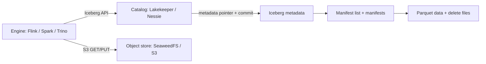

# Lesson 05 — цели и карта занятия

**Prerequisite:** [Lesson 04b — Distributed filesystems and object storage](../../lesson-04b-distributed-storage/README.md). Ученик должен различать bucket/key, object bytes, filer metadata и filesystem path. Это позволяет обсуждать Iceberg snapshot/catalog semantics отдельно от нижнего storage API.

## Учебные цели

К концу занятия ученик:

1. Отличает Iceberg table format от Parquet/Avro и catalog service.
2. Объясняет metadata JSON, manifest list, manifests, data/delete files и snapshots.
3. Прослеживает atomic metadata pointer update и понимает optimistic concurrency conflicts.
4. Разворачивает S3-compatible bucket, bootstraps Lakekeeper и создаёт warehouse.
5. Подключает Flink SQL к Lakekeeper и Nessie через Iceberg REST API.
6. Наблюдает, что объекты остаются в S3 после остановки catalog service.
7. Выбирает каталог по protocol, governance, branching, облаку и эксплуатации.
8. Отличает учебный стенд от production: identity, TLS, HA, database, credentials, backup и table maintenance.

## План на 3 ч 30 мин

| Время | Блок | Свидетельство |
| ---: | --- | --- |
| 0–15 мин | Table format vs object store vs catalog | схема трёх границ |
| 15–45 мин | Iceberg metadata и atomic commit | snapshot metadata chain |
| 45–60 мин | REST catalog и storage credentials | роли Lakekeeper и SeaweedFS названы отдельно |
| 60–75 мин | Поднять стенд | Compose health + endpoint checks |
| 75–115 мин | Lab A: Lakekeeper | aggregate, `$snapshots`, `$files`, SeaweedFS objects |
| 115–145 мин | Lab B: Nessie | второй catalog и S3 prefix |
| 145–170 мин | Сравнение альтернатив | decision matrix |
| 170–195 мин | Production design review | backup/recovery решения |
| 195–210 мин | Debrief + homework | исправленная схема и evidence plan |

## Схема

Каталог сериализует изменения таблицы и определяет current metadata. Object store сохраняет файлы. Engine планирует чтение и пишет файлы. Ни одна роль не заменяет две остальные.

## Deep dives: от концепта до исходного кода

- [Iceberg metadata internals](deep-dives/iceberg-metadata-internals.md) — от задачи Hive-style layout до field IDs, manifests, sequence numbers, deletes и snapshot commit.
- [Catalog и commit protocols](deep-dives/catalog-commit-protocols.md) — REST lifecycle, optimistic CAS, Lakekeeper/Postgres/S3 и Nessie references, conflict/failure matrix.
- [История и альтернативы](deep-dives/table-formats-history-and-alternatives.md) — Iceberg vs Delta Lake/Hudi/Paimon, COW/MOR и выбор по workload.

Каждый deep dive содержит фрагменты кода/SQL, links на спецификацию и upstream реализацию, а также вопросы для senior-level защиты. Воркбук задаёт лабораторный маршрут; deep dives объясняют почему конкретные шаги работают.

## До занятия

- Docker Desktop в режиме Linux containers, около 5 GB свободной памяти Docker.
- Поднять стенд по [student prep](runbooks/student-prep.md).
- Открыть Flink UI, Lakekeeper UI, SeaweedFS filer UI и Nessie API.
- Проверить SQL-сессию и `SHOW CATALOGS;`.
- Не использовать demo credentials как образец production security.

## Проверочные вопросы

- Что гарантирует каталог, если два writer-а одновременно публикуют metadata?
- Почему удаление записи не обязано сразу удалять Parquet object?
- Что увидит Flink при недоступном Lakekeeper, но доступном SeaweedFS? И наоборот?
- Чем отличаются manifest rewrite, compaction и orphan-file cleanup?
- Какую часть состояния версионирует Nessie branch?
- Какие клиенты должны согласовать `FileIO`, format features и credentials?
