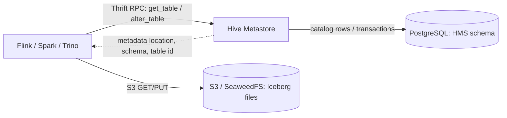

# Deep Dive: Hive Metastore и эволюция каталогов lakehouse

## Главный ответ

Hive Metastore (HMS) по-прежнему полезен: это долговечный общий реестр баз, таблиц, схем и расположений, которым пользуются разные движки. Iceberg может использовать HMS как каталог через `HiveCatalog`. Новые каталоги появились не потому, что HMS «не умеет хранить metadata», а потому, что разные команды хотели другие API, модель эксплуатации, облачную интеграцию, authorization и versioning.

В Iceberg важно не смешать два слоя:

```text
HMS: logical name -> current Iceberg metadata.json location
S3:  metadata.json -> snapshots -> manifest lists -> manifests -> data/delete files
```

Один объектный bucket может содержать все файлы таблицы, но он не объявляет, какая из нескольких версий `metadata.json` сейчас опубликована под именем `finance.orders`. HMS (или другой каталог) отвечает на этот вопрос и предоставляет клиентам операции над namespace/table. Табличный формат Iceberg описывает содержимое и историю таблицы; каталог связывает это описание с логическим именем и реализует точку публикации.

## 1. Что такое HMS технически

HMS — отдельная служба с API поверх Thrift. Клиенты вызывают операции вроде `get_table`, `get_database`, `create_table`, `alter_table`, `get_partitions`; сервис хранит записи в поддерживаемой RDBMS. PostgreSQL здесь является **базой каталога**, а не местом хранения Parquet или Iceberg metadata files. В разработческих установках возможен Derby; для общей службы используют отдельную PostgreSQL/MySQL и настраивают backup, миграции схемы и HA.



В реляционной схеме HMS есть namespace/database, table, storage descriptor, serde, table parameters и, для классических Hive tables, отдельные записи partition. Конкретные таблицы backend-схемы — например `DBS`, `TBLS`, `SDS`, `COLUMNS_V2`, `TABLE_PARAMS`, `PARTITIONS` — это внутренний контракт HMS. Не следует писать в них вручную: клиенты должны использовать HMS API, а upgrade выполняет `schematool`.

### Классическая Hive table и Iceberg table — разные модели

| Вопрос | Классическая Hive table | Iceberg table в `HiveCatalog` |
| --- | --- | --- |
| Где описаны актуальная схема и состояние файлов? | HMS table/partition metadata и договорённости движка о директориях/файлах | Iceberg metadata JSON, snapshot, manifests и file entries на storage |
| Что хранит HMS? | Schema, `StorageDescriptor`, location, input/output/serde и часто записи partitions | HMS table registration, location и Iceberg table parameters; важен `metadata_location` |
| Как движок находит файлы? | В зависимости от table format/engine может перечислять директории и partitions | Читает текущий Iceberg metadata JSON и следует manifest chain, не сканируя bucket как источник истины |
| Кто владеет schema evolution/snapshots? | HMS + конкретная Hive/engine модель | Iceberg спецификация и Iceberg metadata |

Iceberg-aware читатель загружает запись HMS, извлекает `metadata_location`, читает соответствующий JSON и далее следует snapshot → manifest list → manifests. В параметрах HMS обычно также сохраняется `previous_metadata_location`; это полезно для каталожного commit/recovery, но вся история snapshots не переносится в одну большую строку PostgreSQL.

## 2. Как Iceberg commit выглядит через HMS

Допустим, в HMS зарегистрировано `lesson05.orders`, и его `metadata_location` указывает на `s3://warehouse/.../metadata/00007-....metadata.json`.

**Чтение:**

1. Flink обращается к `thrift://hive-metastore:9083` и получает таблицу из HMS.
2. Iceberg `HiveCatalog` берёт `metadata_location` из table parameters.
3. Iceberg `FileIO` читает JSON с object storage. В JSON лежит current snapshot и ссылки на manifest list/manifests.
4. Flink по данным manifest выбирает нужные Parquet и delete files. Schema из Iceberg metadata интерпретируется по field IDs.

**Запись:**

1. Writer фиксирует base metadata version и строит изменение относительно неё.
2. Параллельные task-ы пишут новые файлы данных и metadata на S3. До публикации нового pointer эти файлы ещё могут быть невидимы читателям как часть таблицы.
3. Writer публикует новую metadata version через `HiveCatalog`: сверяет старый `metadata_location`, затем обновляет регистрацию таблицы на новую metadata location. Точный locking path зависит от версии/настроек Iceberg и HMS; при включённой опции Iceberg может использовать HMS lock API как дополнительную координацию.
4. Если обнаружено, что base pointer уже изменился, commit конфликтует. Writer перечитывает состояние, проверяет применимость операции и повторяет commit либо завершает ошибкой. Неуспешно опубликованные S3 объекты не надо удалять синхронно: безопасную очистку выполняют позже политикой orphan-file cleanup.

Схема commit не является общей транзакцией PostgreSQL + S3. База HMS атомарно обновляет свою часть каталога; Iceberg пишет immutable object files отдельно, а затем обновляет pointer. Нужны корректный Iceberg client и поддерживаемая реализацией каталога координация. Для `HiveCatalog` не переносите автоматически предположения об атомарном rename из `HadoopCatalog`.

В реализации Iceberg смотрите [`HiveTableOperations`](https://github.com/apache/iceberg/blob/apache-iceberg-1.12.0/hive-metastore/src/main/java/org/apache/iceberg/hive/HiveTableOperations.java): чтение metadata location, подготовка HMS table record и commit path. Смотрите также [`BaseMetastoreTableOperations`](https://github.com/apache/iceberg/blob/apache-iceberg-1.12.0/core/src/main/java/org/apache/iceberg/BaseMetastoreTableOperations.java), где собраны общие metadata properties и проверка статуса commit.

## 3. Откуда взялся Hive Metastore

Историю полезно понимать через задачу, а не через список релизов.

1. **2007: масштаб данных опережает классический warehouse.** Facebook рассказывал, что их аналитические данные выросли примерно с 15 TB до 2 PB, а части daily processing уже не укладывались в сутки. Hadoop дал горизонтально масштабируемое хранение/вычисления на commodity hardware, но писать MapReduce для простых ad hoc запросов было слишком трудно.
2. **Hive добавил табличную абстракцию и SQL.** В 2007 команда Facebook начала строить Hive поверх Hadoop; в августе 2008 Hive стал open source. Таблицы, колонки, partitions и HiveQL позволили аналитикам работать с файлами через более знакомую warehouse модель.
3. **Metastore отделился от query engine в архитектуре.** Engine нужен для выполнения задачи; метаданные должны быть общими для разных клиентских инструментов. Поэтому таблицы и схемы хранятся отдельно от HDFS data, а Metastore стал общей службой. HCatalog формализовал доступ к этим таблицам для других Hadoop-инструментов, включая Pig и MapReduce.
4. **Thrift + RDBMS дали общую точку учёта.** Несколько процессов могут использовать один namespace и видеть зарегистрированные таблицы; крупная метастор-БД позволяет обслуживать кластер, вместо локальной базы внутри каждой CLI-сессии.
5. **В 2010 Hive и Pig вышли из Apache Incubator как top-level Apache projects.** HMS и его таблицы стали де-факто common metadata contract во многих Hadoop deployments. Экосистема сохранила его интерфейс, даже когда сама обработка переехала на Spark, Flink, Presto/Trino и другие engines.

Facebook описал первопричину Hive, рост данных и публикацию в августе 2008 в [исторической статье команды Data Infrastructure](https://engineering.fb.com/2009/06/10/web/hive-a-petabyte-scale-data-warehouse-using-hadoop/); история перехода Hadoop/Hive к open source также отражена в [материале Facebook 2008 года](https://engineering.fb.com/2008/06/04/core-infra/hadoop/). ASF отмечает выпуск Hive из Incubator в [обзоре Hadoop за 2010 год](https://hadoop.apache.org/news/2010-10-xx-hive-pig.html). Архитектурная мотивация каталога описана в [Hive Design](https://cwiki.apache.org/confluence/display/Hive/Design): каталог скрывает от пользователя детали storage/serde и помогает обнаруживать таблицы.

## 4. Почему Iceberg metadata в S3 недостаточно

У Iceberg действительно лежит большая часть table metadata на storage. Но после десятков commits в каталоге есть несколько `metadata.json`, относящихся к последовательным версиям. Одного bucket listing недостаточно, чтобы решить:

- какая версия является current для логического имени таблицы;
- кто первым опубликовал commit при гонке двух writer-ов;
- как получить namespace и список доступных таблиц;
- как применить DDL и сообщить другим движкам новую точку входа;
- как централизовать identity, credentials, policy, audit и ownership.

Можно обойтись без центрального каталога в отдельных сценариях: передавать движку абсолютный table location, использовать `HadoopTables`/location-based access, хранить locations в приложении или выбрать `HadoopCatalog` там, где filesystem предоставляет требуемые атомарные операции. Тогда приложение само отвечает за discovery, публикацию актуальной версии, права, конкурентные writers и переносимость между движками. У S3 нет универсальной атомарной directory rename семантики, поэтому нельзя считать `HadoopCatalog` автоматически подходящим для S3.

Iceberg на S3 использует catalog implementation, способный координировать pointer updates на выбранном storage/catalog API. HMS — один из вариантов: format metadata остаётся в S3, а HMS отвечает на `table name -> current metadata location`. Lakekeeper, Nessie, Glue и JDBC catalog реализуют ту же роль другим протоколом/моделью.

## 5. Зачем появились другие каталоги

Это не одна линейная замена HMS. Появлялись разные ответы на разные ограничения и требования:

### 5.1 Object storage и open table formats

Классическая Hive table часто опиралась на директории и partitions: чтобы планировать чтение, движку надо было знать множество файлов/partition locations. На object storage массовый `LIST`, rename-as-copy-delete и directory assumptions стоят дорого и/или меняют гарантии. Iceberg перенёс file inventory, snapshot graph, partition spec и schema history в metadata files с явным commit protocol. Это эволюция **table format**, а не обязательно отказ от HMS: первая версия Iceberg могла использовать HMS как pointer catalog.

### 5.2 Разные клиенты, языки и dependency graphs

HMS Thrift — эффективная и зрелая интеграция, особенно в JVM/Hadoop stacks. Но client всё ещё должен говорить с конкретным Thrift API, учитывать версии Hive/Hadoop/Thrift библиотек и загружать совместимый стек jar-ов. Iceberg REST задаёт HTTP API и discovery contract, чтобы разные Iceberg engines могли подключаться к каталогу через общий client protocol. REST не «магически устраняет совместимость»: конкретную версию протокола, endpoints, auth и capabilities всё равно сверяют в PoC.

### 5.3 Cloud и service ownership

В облаке организация может не хотеть держать HMS service, его RDBMS, Thrift network access, schema migrations и on-call. AWS Glue предоставляет managed catalog и IAM-oriented control plane; это снижает число собственных сервисов внутри AWS, но усиливает связь с AWS API, identity, quota и region model. Другим облакам и self-hosted командам нужны альтернативные operational boundaries.

### 5.4 Governance и storage credentials

Современный каталог может управлять warehouse, projects/namespaces, authorization и выдачей временных credentials либо signing-конфигурации. HMS сам по себе — metadata API; полноценные enterprise policies, audit, federation и storage identity обычно требуют дополнительных систем (например, Ranger/IAM) и точной интеграции с каждым engine. REST catalog упрощает одну общую клиентскую границу, но не гарантирует одинаковые механизмы безопасности во всех продуктах.

### 5.5 Branches, tags и согласованное продвижение наборов таблиц

Iceberg snapshot относится к состоянию **одной таблицы**. При тестировании data product может быть полезно создать branch каталога, поменять несколько таблиц и продвинуть весь набор после review. Это отдельный capability. Nessie добавляет versioned references/commits поверх каталога; обычный HMS может индексировать те же Iceberg tables, но сам по себе не даёт Git-подобную branch/merge модель для набора таблиц.

## 6. Сравнение распространённых вариантов

| Вариант | Главная модель | Сильная сторона | Цена/риск и типичный fit |
| --- | --- | --- | --- |
| **Hive Metastore + Iceberg `HiveCatalog`** | Thrift, HMS database, table parameters с current metadata pointer | Максимальная ценность уже существующего Hadoop/Spark/Hive ecosystem; простой shared namespace | JVM/Thrift/Hive dependency compatibility, собственные HA/DB schema backup/upgrade, auth обычно проектируют отдельно. Хорош, если HMS уже стандарт и engines стабильно совместимы. |
| **AWS Glue Data Catalog** | Managed AWS service, AWS API/IAM | Не нужно самостоятельно поднимать HMS и DB; удобная AWS identity/governance-интеграция | AWS coupling, account/region boundaries, quotas/cost/engine matrix. Выбирают, если AWS — системная платформа. |
| **Lakekeeper** | Self-hosted Iceberg REST, projects/warehouses, storage configuration и authorization | REST-клиенты и каталог с выраженной warehouse/storage control-plane моделью | Команда эксплуатирует сервис и его PostgreSQL; надо доказать конкретный auth, credential-vending/remote-signing и engine support. |
| **Project Nessie** | Versioned catalog refs/commits + Iceberg REST и native API | Branch/tag/merge workflows; версионирование состояния многих таблиц | Сложнее модель refs, backend и recovery; не выбирать только потому, что «REST нужен» — нужен именно versioning capability. |
| **Apache Polaris** | Open REST catalog/control plane для Iceberg | Вариант для стандартизованного REST взаимодействия и управления catalog namespaces | Проверить maturity релиза, security/identity, lifecycle и engine coverage конкретной версии. |
| **Apache Gravitino** | Федерация метаданных в metalake и отдельная служба Iceberg REST | Объединяет Hive, Iceberg и другие источники. Iceberg REST может работать поверх существующего HMS или выделенного JDBC backend | Права основного сервера и REST, кэши и обход через прямой HMS, согласованность при concurrent writers. [Разбор Gravitino](gravitino-internals.md) |
| **Hive 4.1+ Iceberg REST over HMS** | Iceberg REST endpoint поверх Hive Metastore backend | Сохраняет HMS backend при REST-клиентской границе; даёт путь миграции API | Это версия-зависимое свойство HMS, не следует переносить на Hive 4.0.1 и старые образы; проверить release, authentication и REST capabilities. |
| **Iceberg JDBC catalog** | Iceberg catalog state в SQL DB | Простая relational deployment модель для команд, умеющих эксплуатировать PostgreSQL/MySQL | Engine integration, DB migrations/HA и auth остаются обязанностью платформы; PostgreSQL JDBC catalog и HMS PostgreSQL — не одно и то же. |
| **Hadoop catalog / location-based tables** | Namespaces/table paths в filesystem/storage | Минимум сервисов и понятный учебный вариант | Для конкурентной записи требуется подходящий commit/rename primitive; S3 требует отдельной проверки, отсутствие сервиса переносит discovery/coordination на клиента. |

Lakekeeper/Nessie/Polaris — разные продукты, даже если все поддерживают REST. Общий protocol — это общий способ общения клиента, а не одинаковые backend storage, semantics, policy или feature set. Кроме того, `HiveCatalog` не равен движку Hive: Flink может обращаться к HMS через HiveCatalog, не запуская Hive SQL или MapReduce.

В новых версиях HMS появился и REST-путь для Iceberg, но это не означает, что классический Hive Metastore Thrift и специализированные REST catalogs стали идентичными. Hive docs описывают REST API и различие двух способов доступа в [HMS Iceberg REST guide](https://hive.apache.org/docs/latest/admin/iceberg-rest-catalog/); релизная заметка называет Hive 4.1.x началом standalone HMS packaging и REST-based catalog server ([Hive releases](https://hive.apache.org/general/downloads/)). В нашем Compose закреплён Hive 3.1.3: он совпадает с поддерживаемой Flink 2.2 Hive client family, а лабораторная использует традиционный Thrift API намеренно. Hive 4.1+ REST — отдельный extension exercise, а не скрытая часть этого Thrift-демо.

## 7. Практика: Flink → HMS Thrift → Iceberg → S3

В этом репозитории роли изолированы:

```text
Flink SQL Client / JobManager / TaskManager
  ├─ HiveCatalog Thrift RPC -> hive-metastore:9083 -> hive-metastore-postgres
  ├─ Hadoop S3A            -> SeaweedFS (Hive database/warehouse path handling)
  └─ Iceberg S3FileIO       -> seaweedfs:8333 -> bucket/de-mentor-warehouse/hive/
```

Регистрация каталога вынесена в [`01-catalogs.sql`](../../../../labs/flink-iceberg/sql/01-catalogs.sql):

```sql
CREATE CATALOG hive_metastore WITH (
  'type' = 'iceberg',
  'catalog-type' = 'hive',
  'uri' = 'thrift://hive-metastore:9083',
  'warehouse' = 's3a://de-mentor-warehouse/hive',
  'io-impl' = 'org.apache.iceberg.aws.s3.S3FileIO',
  's3.endpoint' = 'http://seaweedfs:8333',
  's3.path-style-access' = 'true',
  's3.access-key-id' = 'demouser',
  's3.secret-access-key' = 'demosecret123456',
  'client.region' = 'us-east-1'
);
```

Здесь намеренно задействованы два разных файловых клиента. Hive `Database.locationUri` и warehouse path в этой конфигурации имеют схему `s3a://`, поэтому HMS/Hive client разрешает их через Hadoop `S3AFileSystem`; Flink образ включает `hadoop-aws` и совпадающий Hadoop AWS SDK bundle, а `core-site.xml` задаёт SeaweedFS endpoint, path-style addressing и demo credentials. Iceberg metadata/manifests/data при этом читаются и записываются Iceberg `S3FileIO` из AWS bundle — не HadoopFileIO/S3A. `S3FileIO` понимает `s3a://` locations, поэтому schema URI остаётся совместимой с Hive warehouse semantics, а table IO использует современный Iceberg S3 client. В production эти клиенты могут иметь разные credential providers и network/security policies; не копируй static demo keys. См. [Iceberg S3/S3A guidance](https://iceberg.apache.org/docs/1.12.0/aws/#hadoop-s3a-filesystem).

Полный сценарий есть в [`04-hive-catalog-demo.sql`](../../../../labs/flink-iceberg/sql/04-hive-catalog-demo.sql). Он создаёт database/table, делает bounded insert и читает Iceberg `$snapshots` и `$files`. Для этой лабораторной используется именно Iceberg `HiveCatalog`, встроенный в Iceberg Flink runtime; общий Flink Hive table connector не нужен. В Flink 2.2 документация отдельно отмечает отсутствие опубликованного Hive connector для этой ветки, а Iceberg требует Hive client jars при использовании своего Hive catalog. Образ добавляет Hive 3.1.3 client bundle, `libfb303`, Commons Logging, Hadoop client, `hadoop-aws` и matching AWS SDK; DDL использует Iceberg свойства `catalog-type=hive`, `uri` и `warehouse` ([Flink Hive integration/dependencies](https://nightlies.apache.org/flink/flink-docs-release-2.2/docs/connectors/table/hive/overview/), [Iceberg Flink catalog](https://iceberg.apache.org/docs/1.12.0/flink/)).

### Что наблюдать

1. `SHOW CATALOGS;` показывает три каталога, а `USE CATALOG hive_metastore;` переключает namespace и таблицы на HMS.
2. SeaweedFS показывает объектный prefix `de-mentor-warehouse/hive/` с metadata/data files.
3. Отдельная PostgreSQL `hive-metastore-postgres` содержит структуру HMS. После первого успешного insert можно посмотреть pointer properties:

```powershell
docker compose -f labs/flink-iceberg/compose.yaml exec hive-metastore-postgres `
  psql -U hive -d hive_metastore -c 'SELECT t."TBL_NAME", p."PARAM_KEY", p."PARAM_VALUE" FROM "TABLE_PARAMS" p JOIN "TBLS" t USING ("TBL_ID") WHERE t."TBL_NAME" = $$hms_catalog_comparison$$ AND p."PARAM_KEY" IN ($$metadata_location$$, $$previous_metadata_location$$, $$table_type$$) ORDER BY p."PARAM_KEY";'
```

4. `metadata_location` из PostgreSQL должен указывать на Iceberg metadata JSON object в `hive/`. `snapshot_id` и file paths можно далее сопоставить с Iceberg metadata tables и object storage.
5. Остановка HMS не удаляет SeaweedFS objects, но новые клиенты теряют нормальный путь `namespace.table -> current metadata`. Если S3 работает, каталог не сможет заменить listing и выбрать current metadata по одному имени таблицы.

Не редактируй `TABLE_PARAMS` напрямую и не делай `DROP VOLUME` при обычной остановке. Схема HMS обновляется официальным `schematool`; в Compose отдельная база и volume отделяют состояние HMS от Lakekeeper PostgreSQL.

## 8. Как провести production PoC

Заполняй не рекламную матрицу, а доказательства:

1. **Version matrix:** engine × Iceberg runtime × HMS version × Hive client artifacts × Java × S3 `FileIO`.
2. **Interoperability:** создать таблицу во Flink, прочитать из Spark/Trino; проверить schema evolution, partition evolution, format v2 deletes и `metadata_location` access.
3. **Concurrency:** два writer-а одновременно append; затем append против overwrite/delete. Фиксировать commit conflicts, retry, lock metrics и потерянные/повторённые данные.
4. **S3 failure windows:** обрыв до metadata write, после него до pointer update, после ответа HMS с потерянным ответом клиенту; доказать, какой snapshot остаётся читаемым и как распознать orphan files.
5. **Catalog failure/recovery:** выключить HMS, восстановить Postgres backup и сравнить `metadata_location` с сохранённым S3 metadata. Проверить schema version и порядок roll-forward/rollback.
6. **Identity:** отдельный service user, TLS, Kerberos/SASL или используемая платформой auth, authorization, S3 IAM, secret rotation, аудит DDL/commit.
7. **Capacity/operations:** throttling RPC, client pools, DB connection pool, partitions/table count, cache TTL, lock timeout/heartbeat, schema migrations, restore test и SLO.
8. **Exit path:** зафиксировать, как перерегистрировать table по existing metadata location и какие product-specific properties потеряются при migration.

## Источники

- [Hive Design: Metastore architecture and metadata model](https://cwiki.apache.org/confluence/display/Hive/Design)
- [Hive on Hadoop: origin and scale motivation](https://engineering.fb.com/2009/06/10/web/hive-a-petabyte-scale-data-warehouse-using-hadoop/)
- [Apache Hive Docker Compose: PostgreSQL-backed Metastore service](https://github.com/apache/hive/blob/master/packaging/src/docker/docker-compose.yml)
- [Hive Schema Tool and schema upgrade/install operations](https://hive.apache.org/docs/latest/admin/hive-schema-tool/)
- [Flink 2.2 Hive connector dependencies](https://nightlies.apache.org/flink/flink-docs-release-2.2/docs/connectors/table/hive/overview/)
- [Iceberg Flink catalog configuration](https://iceberg.apache.org/docs/1.12.0/flink/)
- [Hive Metastore-backed Iceberg REST API](https://hive.apache.org/docs/latest/admin/iceberg-rest-catalog/)
- [Iceberg REST protocol motivation and endpoints](https://iceberg.apache.org/docs/latest/rest-catalog/)
