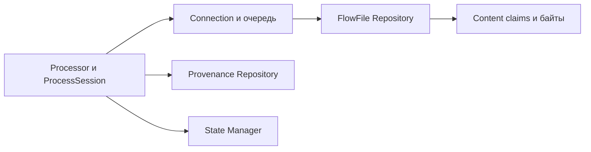

# Deep Dive · Apache NiFi

Этот маршрут предполагает выполненные [практики 01–07](workbook.md). В каждом эксперименте записывай условия, момент отказа, наблюдения и то, какая гарантия проверена. Синтетический контур позволяет повторить серию без внешнего источника.

## 08. Runtime и репозитории



| Слой | Что хранит | Сбой, который стоит проверить |
| --- | --- | --- |
| FlowFile Repository | Метаданные активных FlowFiles, состояние очередей и ссылки на контент | Рестарт при остановленном sink |
| Content Repository | Байты контента, связанные с claims | Срок хранения и возможность получить ранее обработанный документ |
| Provenance Repository | Историю обработки, компоненты и изменения атрибутов | Событие останется доступным дольше его payload в зависимости от настроек |
| State Manager | Состояние процессоров, например информацию о предыдущем листинге | Сравнить эффект перезапуска с повторным листингом при новом state |
| Flow definition | Граф, конфигурацию и привязки | Изменение flow при наличии очередей и external side effects |

Сессия получает документ из очереди, оформляет изменение и публикует следующий локальный шаг через commit. Объекты FlowFile ведут себя как неизменяемые ссылки для API. Поэтому после `session.putAttribute` и `session.write` присваивай новый объект. Клоны могут ссылаться на те же байты до изменения. Проверь это на одной практике с двумя downstream ветками и сравни размеры, атрибуты и общий путь в provenance.

**Backpressure drill.** Поставь объектный порог 2 перед остановленным sink и сохраняй разные результаты для threshold count и bytes. Сравни разную частоту отправки. Проследи, где upstream перестаёт прогрессировать и куда затем перемещается очередь. Спроектируй отдельные правила по времени ожидания, expiration и лимиту retries. Метрика глубины очереди не заменяет метрику возраста.

**Restart drill.** Останови процессор БД, подай тестовую запись и зафиксируй её входную очередь. Перезапусти только NiFi с сохранёнными volumes, дождись UI и проверь тот же FlowFile. После запуска sink сравни SQL. Объясни, почему этот эксперимент проверяет штатный restart, а потеря диска или авария питания требуют отдельной проверки.

В кластере проверь топологию хранилищ узлов, локальный/кластерный scope state, Primary Node для листинга и последствия смены primary. Для ingress оценка в терминах input ports и Site-to-Site отличается от чтения локального файла на конкретном узле. Для публикации рассмотри downstream pressure, skew и предел одновременных задач. [Архитектура и репозитории](https://nifi.apache.org/docs/nifi-docs/html/nifi-in-depth.html) · [Руководство администратора](https://nifi.apache.org/nifi-docs/administration-guide.html)

## 09. Гарантии доставки

| Окно отказа | Что может наблюдаться | Действие |
| --- | --- | --- |
| Между отправкой producer и получением ACK | Неизвестно, зафиксировал ли брокер запись | Сверить контракт producer, transaction ID и видимость результата |
| Kafka уже принята NiFi, downstream ещё ждёт | Offset group прогрессирует, БД прежняя | Проверить очередь, provenance и состояние sink |
| БД зафиксировала результат, NiFi повторил | Два вызова для одного бизнес ID | Уникальный ключ, транзакционный inbox и явный конфликт |
| Внешний API ответил 429 или 503 | Source operation может быть временно запрещена | Backoff, jitter, retry budget, Retry-After и идемпотентный контракт |
| Replay старого update после свежего | Значение может откатиться при простом UPSERT | Conditional update по версии или lock внутри транзакции |
| Offset за пределами retention | Позиция известна, payload уже недоступен | Поднять архив и проверить покрытие диапазона |

Ключ Kafka, UUID FlowFile, source event ID и primary key БД решают разные задачи. Для повторной записи одной операции подходит event ID, который генерируется у источника и переживает перенос между topics. Для обновления сущности отдельно используй identity сущности и монотонную версию.

**Что увидит потребитель с `isolation.level=read_committed`?** Пусть в одном разделе сначала записали обычное сообщение A, затем транзакционное B, затем обычное C. Пока транзакция B открыта, потребитель может получить A. Чтение C задерживается, поскольку потребитель сохраняет порядок смещений. После подтверждения транзакции доступны B и C. При откате потребитель пропускает B и получает C. Такой режим управляет видимостью записей внутри Kafka. Результат внешней операции в PostgreSQL проверяют на стороне базы. [Параметр isolation.level в Apache Kafka](https://kafka.apache.org/42/configuration/consumer-configs/#consumerconfigs_isolation.level)

Пример SQL-границы для обновлений. Таблица `current_order` в этом эскизе содержит PK `order_id`, `source_version` и `payload`. Он иллюстрирует fencing для конфликтующих обновлений. Обнаружение одинаковой версии с другим payload реализуется отдельной проверкой inbox в той же транзакции.

```sql
INSERT INTO current_order (order_id, source_version, payload)
VALUES (?, ?, ?)
ON CONFLICT (order_id) DO UPDATE
SET source_version = EXCLUDED.source_version,
    payload = EXCLUDED.payload
WHERE current_order.source_version < EXCLUDED.source_version;
```

**Задание на replay.** Скопируй диапазон в отдельную проверочную группу. Заранее зафиксируй топик, partitions, начальную и конечную позиции, count и набор бизнес ID. Проверь два совпадающих payload и два конфликтующих с одним ID. Сравни эксперимент с заявлением о гарантиях. Kafka transactions могут связывать выходы и offsets внутри Kafka при поддержке клиентом. Внешние REST/SQL эффекты входят в собственную транзакционную модель. [Kafka delivery semantics](https://kafka.apache.org/42/design/design/) · [NiFi ConsumeKafka](https://nifi.apache.org/components/org.apache.nifi.kafka.processors.ConsumeKafka/)

## 10. Эксплуатация

| Симптом | Что проверить сначала | Доказательство |
| --- | --- | --- |
| Нет свежих данных, lag=0 | Растёт ли LEO у верного topic, работает ли источник, нет ли ошибочной схемы/БД | Метрики публикации и запрос результата по событию |
| Kafka прогрессирует, очередь растёт | Состояние sink, throughput, зависшие retriable FlowFiles, pool connections | Время первой и последней записи, размер и возраст очереди |
| Ночью трафик вырос только в одной partition | Распределение ключей и rate по partition, согласованность групп | По каждому ключу порядок и доля нагрузки |
| Ошибки исчезли после выкладки, данных тоже нет | Auto-terminate, маршруты и смена Controller Service/parameters | Provenance конкретного ID и контрольный результат |
| Операция необратима, HTTP обрывается | ID операции, статус у получателя и видимое бизнес-состояние | Восстановление по журналу или контролируемый повтор |
| Подозрение на тихую потерю данных | Сверка ID, версий, хешей и времени, начиная с источника | Разница наборов, а не только COUNT |

**Управление изменениями.** Экспортируй определение Process Group в Git вместе с контрактами, fixtures, планом миграции параметров, бэкапом и инструкцией отката. Проверь, что чувствительные значения передаются через управляемые параметры и отсутствуют в опубликованных образцах. При смене версии учитывай оставшиеся queues, schemas и состояние компонентов. Для 2.x выбирай механизм versioning по поддерживаемому Flow Registry Client и редакции продукта. [NiFi User Guide](https://nifi.apache.org/nifi-docs/user-guide.html)

**Производительность.** Сравнение начни с baseline. Измерь records/s, latency до БД, возраст очереди, размер FlowFile, JVM heap, disk IO, время запросов и число FlowFiles в секунду. Затем поменяй только один параметр, например `Concurrent Tasks` или размер batch. Объясни разницу между разгоном источника, замедлением downstream и нагрузкой на Content Repository.

**Экзамен на операторское рассуждение.** Для всех трёх инцидентов из [итогового проекта](capstone.md) запиши время, impact, первое наблюдение, гипотезу, проверку, действие, результат и отдельный критерий для применения rollback.
